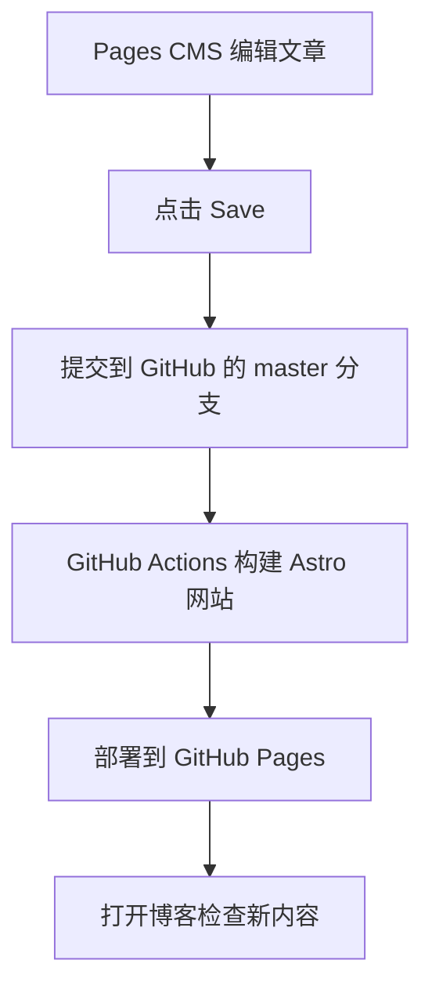

# Player's DevLog 博客日常使用手册

适用项目：`D:\Blog\Firefly`。内容管理改造日期：2026-10-31；原有文章使用说明继续保留。

这份手册按现有 `.pages.yml`、`src/content.config.ts`、文章加载代码和 GitHub Actions 工作流编写，也核对了远程 `master` 的配置及图片路径。日常写一两篇文章用 Pages CMS；批量搬运学习笔记用 GitHub Desktop。

快速查阅：[日常写文章](#一日常写文章从登录到发布) · [图片管理](#二图片管理目录与链接怎么对应) · [导入笔记](#三把电脑中的-markdown-学习笔记导入博客) · [发布流程](#四发布流程save-之后发生了什么) · [个人资料与外观](#七个人资料与博客外观) · [动态](#八发布与管理动态) · [视频](#九添加与管理视频) · [音乐](#十管理歌单与音乐播放器)

文章怎么起标题、分小节、添加系列，以及以后如何另写一篇续上，请看 [随手写文章与系列续写模板](./post-writing-guide.md)，内含可直接复制的 Markdown 模板。

友链由后台「友链管理」维护；文章详情页已接入公共浏览量统计。配置依据、操作步骤和计数范围见 [友链与文章浏览量](./friends-and-page-views.md)。

留言板与文章评论采用 Giscus；后台「评论管理」可查看、搜索和删除真实评论，操作步骤与同步说明见 [留言板与文章评论](./guestbook-and-comments.md#在-pages-cms-查看和删除评论)。

## 先收藏这几个入口

| 用途 | 地址或位置 |
| --- | --- |
| 博客网站 | <https://playerkkk1.github.io/> |
| Pages CMS 后台 | <https://app.pagescms.org/> |
| GitHub 仓库 | <https://github.com/Playerkkk1/playerkkk1.github.io> |
| 自动构建、部署记录 | <https://github.com/Playerkkk1/playerkkk1.github.io/actions> |
| 发布分支 | `master` |
| 文章目录 | `src/content/posts/` |
| CMS 图片目录 | `public/uploads/posts/` |
| 本地项目目录 | `D:\Blog\Firefly` |

后台内容入口依次是「Markdown 文章」「动态管理」「评论管理」「友链管理」「个人资料」「博客外观」「视频管理」「音乐管理」，并保留「Redis 旧文（源码编辑）」。媒体入口包括「文章图片」「头像与壁纸」「动态图片」「视频封面」「音乐文件」「音乐封面」。内容和媒体的分组位置以官方界面为准。按钮保留官方英文名，方便对照界面，例如 **Add an entry**、**Save**、**Upload**、**Select**、**Delete**。手机窄屏可能只显示对应图标。

本文的点击步骤核对了官方界面实现，但没有代你登录后执行保存、删除等操作。托管后台升级后，按钮位置或语言可能微调；以同名按钮和功能为准。

## 一、日常写文章：从登录到发布

### 1. 打开后台并登录

1. 浏览器打开 <https://app.pagescms.org/>。
2. 按登录页面提示使用 GitHub 账号登录，选择有仓库写权限的 `Playerkkk1` 账号。
3. 在仓库选择页打开 `Playerkkk1/playerkkk1.github.io`。
4. 检查仓库顶部或分支选择器，确认分支是 **master**。
5. 在左侧点击 **Markdown 文章**，看到文章或文件夹列表后即可开始操作。手机端先展开侧边菜单。

若仓库不在列表中，按页面提示安装或配置官方 Pages CMS GitHub App；在 GitHub **Settings → Applications → Installed GitHub Apps** 中找到该 App，点击 **Configure**，只给它授权这个博客仓库，再回后台刷新。已有授权时不用重复安装。

### 2. 新建一篇 Markdown 文章

1. 左侧点击 **Markdown 文章**。
2. 在列表右上角点击 **Add an entry**；窄屏可能显示加号。
3. 如果希望文章放进现有文件夹，先在列表中进入文件夹，再点击该按钮。例如 MySQL 笔记进入 `mysql-notes`。
4. 填写文章标题和下表中的其他字段。
5. 找到创建页面的文件名输入框，将自动生成的名称检查一遍，建议改为 `2026-10-30-java-collections.md` 这样的英文短名，保留 `.md` 后缀。
6. 先保持「草稿」开启，在正文区域写内容，最后点击页面右上角 **Save**。

**文章标题可以是中文，文件名建议使用英文、数字和短横线。** 当前自动命名基于标题生成文件名，全中文标题可能生成不完整的短名；远程目前已有 `2026-10-30-.md`，所以新建时不要直接忽略文件名。本文不改名任何现有文章。

文件名通常决定文章网址。例如 `src/content/posts/2026-10-30-java-collections.md` 对应 `/posts/2026-10-30-java-collections/`。普通标题修改不会自动要求重命名文件；文章发布后尽量保持文件名不变。

### 3. 各字段怎么填

| 界面字段 | 怎么操作 | 示例与注意事项 |
| --- | --- | --- |
| 文章标题 | 在输入框中填写中文标题 | `Java 集合：ArrayList 入门`；必填 |
| 发布日期 | 点击日期框或日历，选择年月日 | `2026-10-30`；必填，不需要填时间 |
| 文章摘要 | 在多行文本框中写一两句概括 | 写文章讲什么，不要粘贴整篇正文 |
| 分类 | 填一个分类名称 | `Java`、`Spring Boot`、`MySQL`；一个分类是一个字符串 |
| 标签 | 点击 **Add an item**，每增加一项填一个标签 | 分别填 `Java`、`集合`、`后端`，不要用一项写成 `Java,集合,后端`；不需要的空项用该项移除按钮删掉 |
| 系列名称 | 填写这篇所属的系列，独立文章留空 | 同系列始终填写 `六级学习笔记`，不要每篇换名；不需要预先建立系列 |
| 系列顺序 | 填写阅读顺序数字 | 第一篇填 `1`，下一篇填 `2`；可留空，空值排在已填写顺序的后面；没有系列名称时不参与系列导航 |
| 草稿 | 开关开启表示暂不在正式网站显示 | 新建默认开启；准备发布时关闭，然后再 Save |
| 置顶 | 开关开启后，该文章会优先排在文章列表前面 | 与草稿无关；草稿即使置顶也不会正式显示 |
| 封面图片 | 点击该字段下的 **Upload** 或 **Select** | 可选，一篇文章一个封面；与正文图片分别设置 |
| 单篇许可名称 | 通常留空，继承站点默认许可 | 默认 `CC BY-NC-SA 4.0`，适用于有权授权的原创文字与自制图表；仅在确有授权依据时单独指定 |
| 单篇许可链接 | 自定义许可时填官方 HTTPS 协议链接 | 使用默认许可时留空；不要填文章网址 |
| Markdown 正文 | 在正文框中选择 **Editor** 或 **Source** | 前者可视化排版，后者直接写 Markdown |

**标签添加后没有输入框时：** 确认后台选择的是 `master` 分支，刷新页面后重新打开文章。标签列表的 `default` 不能设为 `[]`：Pages CMS 会把它同时用作新增项的值，点击 **Add an item** 实际追加空数组，因而没有新增输入框。当前配置已移除该默认值；新文章仍从空列表开始，已有标签不受影响。每次添加后填一个标签，再点击 **Save** 保存。

日期目前用于显示和排序，**不提供定时发布**。现有代码只按 `draft` 过滤正式文章，没有“到达发布日期才显示”的判断。将日期填到未来，也不会自动变成预约发布。

草稿控制网站展示，不是私密存储；文章一旦保存到公开 GitHub 仓库，源码仍可被别人查看。

### 文章许可怎么理解

文章末尾默认显示 **CC BY-NC-SA 4.0（署名—非商业性使用—相同方式共享）** 及中文使用说明：作者有权授权的原创文字与自制图表允许按协议进行非商业分享和改编，需署名、附原文与协议链接、注明修改，改编后按相同协议共享。参考 [官方中文协议说明](https://creativecommons.org/licenses/by-nc-sa/4.0/deed.zh-hans)。

课程截图、教材、真题、引用文字和第三方代码遵循原权利人的授权或适用的法律规定，不因为出现在博客里就自动变成作者可以授权的原创内容。引用时仍应在正文标明实际来源；新增许可说明也不等于取得了第三方材料的使用授权。代码示例如需采用软件许可，应明确标注相应协议；不把它们一概视为 MIT 授权。主题程序继续遵循仓库原有 `LICENSE`。

通常保持两个「单篇许可」字段为空即可。需要覆盖默认许可时，同时填写许可名称和官方链接；正文来源说明仍写在正文中。清空两个字段可恢复站点默认许可。单篇自定义时不会同时出现默认 CC 使用条款，第三方材料说明继续显示。默认配置位于 `src/config/licenseConfig.ts`，通过共用组件覆盖所有未指定单篇许可的文章。

### 4. 在 Editor 可视化模式写正文

1. 滚动到 **Markdown 正文**。
2. 点击该字段标题附近的 **Editor**。
3. 点击正文空白处，直接输入文字；按 Enter 开始下一段。
4. 需要标题时，在新的空段落输入 `/`，选择 **Heading 2** 或 **Heading 3**，再输入小节标题。文章总标题已经由上面的标题字段提供，正文一般从二级标题开始。
5. 需要列表、引用、表格时，同样输入 `/`，选择相应的列表、**Quote**、**Table**。
6. 需要加粗、斜体、链接时，先选中文字，再在出现的浮动工具栏中选择对应格式。
7. 修改完点击页面右上角 **Save**，等待成功提示；如果上传图片还没完成，先等上传完成。

Editor 主要用于普通 Markdown。它不是博客真实页面预览；头像、三栏布局、主题色等最终效果要去博客网站检查。

### 5. 切换 Source 模式写 Markdown

1. 找到 **Markdown 正文**标题旁的 **Source**，点击切换。
2. 在文本框里直接编写 Markdown。
3. 普通 Markdown 可以切回 **Editor** 看排版；有 Firefly 特殊语法时，保持 Source 编辑和保存。
4. 点击页面右上角 **Save**。

**这个 Source 只包含正文，不是整篇文件。** 标题、日期、分类等已经由上面的表单管理，不要把 `---` 包围的 Frontmatter 再粘进正文。完整文件格式在后面的“导入笔记”章节。

可以复制下面这段正文开始写：

````markdown
## 学习目标

理解 ArrayList 的基本用法。

### 示例代码

```java
List<String> names = new ArrayList<>();
names.add("Player");
System.out.println(names);
```

- 今天学会了什么
- 还有什么问题

> 这里写一个提醒。
````

包含 `:::` 自定义指令、数学公式、复杂 HTML、特殊图表语法的旧文章，建议直接用 Source。Editor 往返转换可能重新排版或丢失不认识的语法；`merge: true` 只保护额外 Frontmatter 字段，不能保护所有特殊正文语法。

### 6. 插入 Java、SQL 等代码块

使用 Source 最容易保证语言标记正确：

1. 点击正文的 **Source**。
2. 在代码前空一行，输入三个英文反引号，后面紧接语言名，如 `java` 或 `sql`。
3. 下一行开始粘贴代码。
4. 在代码末尾另起一行，输入三个反引号结束代码块，再空一行写其他内容。

Java 示例：

````markdown
```java
public class Hello {
    public static void main(String[] args) {
        System.out.println("Hello, Player!");
    }
}
```
````

SQL 示例：

````markdown
```sql
SELECT id, name
FROM users
WHERE id = 1;
```
````

Editor 中也可在空段落输入 `/`，选择 **Code block**，再粘贴代码。如果需要指定语言，切到 Source，检查开头是 ` ```java ` 或 ` ```sql `（实际输入时去掉两侧空格）。普通行内代码使用单个反引号，例如 `` `SELECT` ``。不要用普通引号代替反引号，也不要把整段代码粘成一段普通文字。

### 7. 插入正文图片、设置封面

**正文中选择已有图片：**

1. 在正文 **Editor** 中，把光标放到要插图的空段落。
2. 输入 `/`，选择 **Image**。
3. 在 **Select images** 窗口找到图片，点击缩略图选中。
4. 点击窗口底部 **Select**，图片插入正文。
5. 若图片尚未上传，在同一窗口点击 **Upload**，选电脑里的图片，等成功后再选中并点击 **Select**。
6. 点击文章页面右上角 **Save**，把正文的图片引用保存下来。

也可以先去左侧「文章图片」上传，再回来插图。Source 模式下插图的方法见“图片管理”。

**设置封面：**

1. 找到文章表单的 **封面图片**字段。
2. 点击 **Upload** 上传新图，或点击 **Select** 从媒体库选图。
3. 在选择窗口中选一张，点击底部 **Select**。
4. 回到文章确认缩略图，再点击右上角 **Save**。
5. 已有封面需要更换时，先用封面旁的 **Remove** / 垃圾桶移除字段中的旧选择，再选新图。这个移除只清空封面引用，不会删除媒体库里的原文件。

上传图片会先保存图片文件；文章的封面或正文引用还要通过文章页面的 Save 保存。两者不要混为一步。

### 8. 保存、编辑、下线和删除文章

**保存：** 点击文章页面右上角 **Save**，等待成功提示。它会把改动提交到所选 GitHub 分支，不只是存在浏览器里。当前配置没有另一个独立的“发布”按钮：关闭草稿后 Save，就是提交正式文章。

**编辑：** 左侧 **Markdown 文章 → 对应文件夹 → 点击文章标题或 Edit**，修改内容后 Save。列表上方的 **Search entries...** 可查找当前列表中的文章；找不到时先进入正确文件夹，嵌套文件夹中的条目不一定显示在当前层。

**暂时下线：** 打开文章 → 开启「草稿」→ Save → 等部署成功。这样可以保留文章源文件，稍后关闭草稿再次发布。

**删除：**

1. 打开准备删除的文章，确认标题和文件名。
2. 点击页面右上角 **Save** 附近的三点菜单；也可使用列表行的三点菜单。
3. 点击 **Delete**。
4. 在确认窗口核对文件路径，再点击 **Delete**。
5. 等 GitHub Actions 部署成功，文章才会从正式网站移除。

删除文章不会自动清理它使用的图片。想恢复误删内容，可以在 GitHub 文件历史或 GitHub Desktop 历史中找回文件，再提交恢复；不要靠重新创建同名空文件来恢复内容。

### 9. 确认文章发布成功

1. 确认「草稿」已关闭，并点击过 Save。
2. 打开仓库的 **Code** 页，选择 `master`，进入 `src/content/posts/`，确认文章文件存在、内容已更新。
3. 点击仓库顶部 **Actions**，打开对应这次保存的最新运行记录。
4. 找到 **Deploy to GitHub Pages**，等待其中 **build** 和 **deploy** 两个任务均成功。
5. 打开 <https://playerkkk1.github.io/>，在首页、分类页、归档或搜索中查找文章；也可按文件名打开文章地址。
6. 检查标题、正文、代码块和图片；电脑上按 **Ctrl + F5** 强制刷新一次，手机上也看一遍。

后台能看到文章、GitHub 有文件、或某一个检查变绿，都不等于这次部署已经完成。要以对应提交的部署记录和实际网站效果为准。

## 二、图片管理：目录与链接怎么对应

### 1. 先记住仓库路径和网站路径的区别

| 场景 | 正确示例 |
| --- | --- |
| GitHub 实际存储路径 | `public/uploads/posts/mvv2uxs4-sz5uzwwe.png` |
| Markdown 或封面引用路径 | `/uploads/posts/mvv2uxs4-sz5uzwwe.png` |
| 网站完整访问地址 | `https://playerkkk1.github.io/uploads/posts/mvv2uxs4-sz5uzwwe.png` |
| 错误的网站引用 | `/public/uploads/posts/mvv2uxs4-sz5uzwwe.png` |

上面这张 PNG 是 2026-10-30 在远程 `master` 中确认存在的真实图片。当时正确的完整网站地址返回 **200 / image/png**，加上 `/public/` 的错误地址返回 **404**。可以打开[这张图片](https://playerkkk1.github.io/uploads/posts/mvv2uxs4-sz5uzwwe.png)理解区别；该远程检查快照不代表之后文件仍未变化。

原因很简单：Astro 把 `public` 目录里的东西直接放到网站根目录，所以网址里要去掉最前面的 `public`。当前站点是用户主页仓库，`base` 为 `/`，图片网址不需要再加 `/playerkkk1.github.io/` 这一段。

### 2. 媒体界面里出现 public 文件夹，是正常的吗

本次只读检查得到的远程结构如下：

```text
public/uploads/posts/             ← 正确的 CMS 媒体根目录
├── .gitkeep                      ← 正常的空目录占位文件
├── mvv2uxs4-sz5uzwwe.png          ← 已上传图片，位置正确
└── public/                       ← 多出来的一层
    └── uploads/
        └── posts/
            └── .gitkeep          ← 本次核对时，这一层只有占位文件
```

因此，媒体列表中看到的 `public` 是一个**真实存在的多余子目录**，不是“每次上传都必须进入的目录”。它对应的是 `public/uploads/posts/public/`，不能和项目顶层的 `public/` 混淆。

本地与远程的 `.pages.yml` 内容一致，期望根目录仍是 `public/uploads/posts`；单凭目录不能确定是哪一次创建或上传造成重复层级。当前正确 PNG 不受这个空子目录影响。本次写手册没有删除它，也没有同步、移动远程文件。

日常上传时先停在「文章图片」的根层级，不要先进入这个 `public`。新建专题文件夹时只填 `mysql`、`java` 等相对名称，不要再次填整段 `public/uploads/posts`。创建后到 GitHub 核对一次；若仍出现重复前缀，先改用 GitHub Desktop 管理目录，不要继续向内层上传。

如果以后决定清理：先在 GitHub 的 `master` 分支进入**嵌套**的 `public/uploads/posts/public/uploads/posts/`，重新确认里面只有 `.gitkeep` 且没有图片或文章引用，再打开这个嵌套占位文件，使用文件菜单的删除操作并提交。Git 不保存空目录，最后一个文件删除后，空的重复层级会消失。不要删除媒体根目录下正常的 `.gitkeep`，也不要删除正确的 PNG。若届时目录已有其他文件，应先检查用途再处理。

### 3. 通过「文章图片」上传

1. 后台左侧点击 **文章图片**。
2. 看顶部面包屑，回到该媒体库根层级；专题图也可以先进入自己建好的 `mysql` 等子目录。
3. 点击媒体列表右上角 **Upload**。
4. 在 Windows 文件选择窗口中选中图片，点击 **打开**；多张图可用 Ctrl 或 Shift 多选。
5. 等待上传成功提示和缩略图出现。
6. 记录上传后的实际文件名，再去文章中选择或引用它。

允许格式为 PNG、JPG、JPEG、WebP、AVIF、GIF。当前启用了随机命名，所以上传 `截图.png` 后，后台可能显示完全不同的文件名；**引用后台最终名字，不要继续写电脑里的旧名字**。这个后台接收图片，不用于上传 `.md`、PPT、Word、ZIP 或整个项目目录。

需要分类目录时，媒体列表顶部文件夹加号的提示为 **Create folder**。只创建媒体根目录内的相对子目录，然后进入该目录上传。大量截图建议用后面的 GitHub Desktop 方法，避免逐张上传产生很多次提交和构建。

### 4. 如何获取图片引用路径

不要假设界面一定有“复制网站链接”按钮，使用下面任一方法：

**方法 A：让编辑器自动插入。** 在文章 Editor 中用 `/ → Image` 选择图片，再切到 Source，查看自动生成的 ``；括号中的路径就是正文使用的路径。检查它是否以 `/uploads/posts/` 开头。

**方法 B：从 GitHub 确认真实路径。**

1. 在「文章图片」找到该图，点击文件卡片旁的三点菜单。
2. 点击 **View on GitHub**。
3. 在 GitHub 看路径，例如 `public/uploads/posts/mysql/xxx.png`。
4. 去掉开头的 `public`，在前面保留 `/`，得到 `/uploads/posts/mysql/xxx.png`。
5. 需要验证时，把它接在 `https://playerkkk1.github.io` 后，在新标签页打开；新图需要等包含该图的部署完成。

GitHub 的 `.../blob/master/...` 是文件展示页面，不要把这个页面地址当作博客图片链接。`_astro/` 下的哈希图名是构建产物，也不要复制回原笔记长期使用。

### 5. 在 Source 中插入图片

1. 先上传或确认图片已在 GitHub 的正确目录。
2. 打开文章，点击正文 **Source**。
3. 在合适位置另起一段，按下面格式填写：

```markdown

```

4. 点击右上角 Save，等部署完成后打开文章检查。

方括号里写图片内容说明，括号里写图片路径。说明有助于理解截图，也会被博客的图片说明功能使用。后文的 `mysql-index-demo`、`example` 等名称都是格式示例，不能当作已上传的真实文件直接引用。

### 6. 修改、替换、重命名和删除图片

**修改图片内容：** 先在电脑上用图片软件裁剪或修正，再作为新图上传。当前 CMS 配置没有启用在线图片裁剪或绘图功能。

**替换一篇文章里的图：**

1. 上传修正后的新图，记住新路径。
2. 打开对应文章 → Source，把旧 `` 的路径换成新路径；封面则先 Remove 旧选择，再 Select 新图。
3. Save，等部署完成，打开文章确认新图正常。
4. 旧图没有被其他文章使用时，再考虑删除它。

随机命名不会保证上传同名文件覆盖旧文件，所以“重新上传同名图”不能代替修改文章引用。

**重命名：** 在「文章图片」找到文件 → 三点菜单 → **Rename** → 在窗口中修改媒体根目录内的相对路径 → 点击 **Rename**。随后手动更新所有使用它的 Markdown 和封面路径。不要假定 CMS 会替你改完全站引用。

**删除：**

1. 先查图片文件名是否仍在其他文章正文、封面或其他页面中使用。数量多时，在 VS Code 打开博客项目，用 **Ctrl + Shift + F** 搜索这个文件名。
2. 在「文章图片」中找到文件 → 三点菜单 → **Delete**。
3. 在确认窗口核对路径，再点击 **Delete**。
4. 等部署完成后复查涉及的页面。

删除媒体文件和移除文章中的图片引用是两件事。前者删仓库文件，后者只改文章；不要把封面字段的 Remove 当成媒体删除。

### 7. 上传成功但网页不显示，按这个顺序查

| 检查项 | 具体怎么查 |
| --- | --- |
| 图片是否真正入库 | GitHub 选择 `master`，进入 `public/uploads/posts/` 或对应子目录，看是否有文件 |
| 是否上传到多余 public 目录 | 对照完整仓库路径，不要只看缩略图；如果在嵌套目录，实际网址也会多出相应路径 |
| 链接有无多写 public | 正常媒体根目录图片应是 `/uploads/posts/...`，不是 `/public/uploads/posts/...` |
| 随机文件名有无用错 | 以 CMS 上传后的名字为准，包括扩展名 |
| 大小写、空格、斜杠是否一致 | GitHub Pages 上 `Demo.png` 和 `demo.png` 不等价；URL 使用 `/`，不用 Windows 的 `\` |
| 有没有保存文章引用 | 上传后回文章页面还要 Save；文章正文中需要有图片语法，或封面字段有值 |
| 是否部署了含这张图的提交 | Actions 中确认对应部署成功；不能只看之前某一次绿色记录 |
| 直接图片 URL 能否打开 | 图片 URL 也 404，就先修路径或检查部署；URL 能打开但文章不显示，再查文章引用、草稿和缓存 |
| 是否用了本地专用路径 | `D:\...`、`C:\...`、`file:///...`、临时剪贴板目录不能供访客访问 |

### 8. 大量学习笔记截图怎么管理

小量插图可用 CMS；几十张、上百张截图更适合一次复制到博客目录，通过 GitHub Desktop 提交。不要把已经迁入的 MySQL 图片再上传一遍。

推荐两种组织方式，选择一种用于一批新笔记即可：

| 方式 | 图片实际位置 | 正文示例 | 适用情况 |
| --- | --- | --- | --- |
| CMS 媒体集中管理 | `public/uploads/posts/java/` 等专题子目录 | `` | 想在「文章图片」统一管理 |
| 与文章一起存放 | `src/content/posts/java-notes/images/` | `` | 从 Typora 等工具批量搬笔记，保留相对结构 |

集中管理时按技术主题或文章短名分组，例如 `java/collections/`、`spring-boot/login/`、`mysql/index/`。通过 Desktop 批量复制时可以保留有意义的原文件名；CMS 上传则仍使用随机文件名，所以要靠文件夹、缩略图和文章引用来识别。

截图应裁掉无关区域，文字保持清晰；不要把学习资料里的视频、安装包、完整课件一并放进图片目录。原始笔记和原图继续留在学习笔记目录，博客使用的是副本。

已有 MySQL 的 31 张图位于 `src/content/posts/mysql-notes/images/`，使用 `./images/...`；它们不属于「文章图片」的 `public/uploads/posts` 媒体库。媒体库看不到这些旧图，不等于网站丢图；不要为此重写原有链接。后台相对图预览若和正式站不同，先在本地或正式站核验。

## 三、把电脑中的 Markdown 学习笔记导入博客

### 1. 少量内容：复制正文到 Pages CMS

1. 在电脑上用 VS Code、Typora 等打开原 `.md` 文件。
2. 在 CMS 点击 **Markdown 文章 → Add an entry**。
3. 填标题、日期、摘要等字段。
4. 正文选择 **Source**，只粘贴正文；若原文件已有 Frontmatter，不要连同它一起粘贴。
5. 将本地图上传到「文章图片」，把正文中的图片路径改为实际上传路径。
6. 用草稿状态 Save，检查无误后关闭草稿并再次 Save，等待部署。

CMS 的 Upload 在本配置中用于图片，没有为文章集合配置一个“上传 .md 文件并自动转换”的入口。需要原样导入文件时用下面两种方法。

### 2. 少量文件：通过 GitHub 网页上传 .md

1. 先在电脑上给 `.md` 补好 Frontmatter，并处理图片路径。
2. 打开 GitHub 仓库 → **Code**，分支选择 **master**。
3. 进入 `src/content/posts/`，或已有的 `java-notes` 等目标子目录。
4. 在文件列表上方点击 **Add file → Upload files**。
5. 拖入准备好的 `.md`，或点击 **choose your files** 选文件。
6. 检查页面上待上传文件的完整路径，避免把 `src/content/posts` 再嵌套一次。
7. 点击 **Commit changes**；若出现提交信息和分支确认窗口，填写说明、确认 `master`，再完成提交。按钮可能随 GitHub 页面版本显示为提交或提议变更；若只能走新分支，应合并到 `master` 后才会发布。
8. 图片也要进入对应仓库位置，再等包含完整文章与图片的部署成功。
9. 回 CMS 刷新列表；标准 `.md` 可继续用表单编辑。

文章少而图片多时，更建议 Desktop 一次提交齐全的文件，避免文章先发布而图片尚未上传。

### 3. 批量导入：通过 GitHub Desktop

**先接入已有本地项目，不要再向同一路径克隆一份：**

1. 打开 GitHub Desktop，登录自己的 GitHub 账号。
2. 菜单 **File → Add local repository...**，点击 **Choose...**，选择 `D:\Blog\Firefly`，再点击 **Add repository**。
3. 左上方 **Current repository** 确认是博客；**Current branch** 选择 `master`。
4. 点击上方 **Fetch origin**。如果出现 **Pull origin**，先点击拉取远程新提交。

CMS 在线保存不会自动更新电脑里的项目。本次核对时，远程已有测试文章和上传图片，而本地还没有对应文件，因此“先 Fetch / Pull”尤其重要。如果本地 Changes 里已有未提交修改，先保留并处理这些修改，按 Desktop 提示同步；不要点 Discard 清空自己的工作，也不要强制推送覆盖远程。

**再复制、检查、提交：**

1. 在 Desktop 点击 **Repository → Show in Explorer**，打开博客目录。
2. 用资源管理器把学习笔记**复制**到 `src/content/posts/` 下的新专题文件夹；保留原笔记不动。例如复制到 `java-notes/`、`spring-boot-notes/`。
3. 将正文实际引用的图片一同复制。相对图就保留文章旁边的 `images/` 或原 `xxx.assets/` 目录；集中图就放到 `public/uploads/posts/专题/`，然后改链接。
4. 用 VS Code 检查每篇 `.md` 的 Frontmatter、图片路径、标题层级和代码块。
5. 在 PowerShell 中执行本节末尾的本地检查；构建成功后预览并检查图片。
6. 回 Desktop 的 **Changes**，逐个检查待提交文件，确保只包含这批笔记和相关图片。不要夹带 `.git/`、`node_modules/`、安装包或其他项目文件。
7. 左下角 **Summary** 填简短说明，例如 `content: import Java collection notes`，点击 **Commit to master**。这一步只创建本地提交。
8. 点击顶部 **Push origin**，才会把这些提交发送到 GitHub 并触发自动发布。
9. 去 GitHub **Actions** 查看部署，成功后打开博客验收。

本手册解释 Push 的操作，但编写手册时不会替你执行提交或推送。遇到冲突先对照两边内容解决，不要用 Force push 代替同步。

### 4. 导入文件必须有正确 Frontmatter

**文件第一行就是 `---`**，前面不要留空行；保存为 UTF-8。下面是一篇完整文件的模板，示例路径需要替换成自己实际上传的图片：

````markdown
---
title: "Java 集合：ArrayList 入门"
published: 2026-10-30
description: "记录 ArrayList 的常用操作。"
category: Java
tags:
  - Java
  - 集合
  - 后端
draft: true
pinned: false
image: ""
series: "Java 学习笔记"
seriesOrder: 1
---

## 一、基本用法

```java
List<String> names = new ArrayList<>();
names.add("Player");
```

## 二、运行结果


````

手工编辑时重点检查：

| 项目 | 正确写法 | 常见错误 |
| --- | --- | --- |
| 日期 | `published: 2026-10-30` | 加引号变成字符串、写成中文日期、使用 `date` 代替 `published` |
| 标签数组 | `tags: [Java, 后端]` 或上面的逐行列表 | `tags: Java, 后端` 只是一个字符串 |
| 布尔值 | `draft: true`、`pinned: false` | `"true"`、`"false"` 是字符串 |
| 分类 | `category: "Spring Boot"` | 把分类误写成数组 |
| 封面 | `image: ""` 或单个图片路径 | 多图数组、电脑绝对路径 |
| 系列顺序 | `seriesOrder: 1` | 把数字写成 `"1"` |

标题和摘要包含冒号等字符时，像模板一样加引号更稳妥。正文中所有围栏代码块都要闭合；已有 `==高亮==`、本地专有语法也应检查是否需要转换为普通 Markdown。

### 5. 本地图片路径怎么改

例如文章放在：

```text
src/content/posts/java-notes/
├── 01-arraylist.md
└── images/
    └── java-list-result-01.png
```

则该文章正文写：

```markdown

```

如果原笔记是 `MySQL.md` 配 `MySQL.assets/`，也可以把它们保持相对位置一起复制；不一定要把每张图都改为 CMS 媒体路径。图在 `src` 中时，正文的相对图片交给 Astro 构建处理。

原来写成 `D:\02_学习笔记\...\截图.png`、`file:///D:/...`、临时剪贴板路径的，要换成已经复制到博客的相对路径，或 `/uploads/posts/...` 公共路径。图片路径统一用 `/`。文章改名或移到别的文件夹时，重新核对相对关系。

### 6. Java、Spring Boot、MySQL 笔记如何组织

推荐一门技术一个目录，一篇文章一个清楚的小主题。下面是新笔记的组织建议，不是已经创建的文件：

```text
src/content/posts/
├── java-notes/
│   ├── 01-basics.md
│   ├── 02-collections.md
│   └── images/
├── spring-boot-notes/
│   ├── 01-getting-started.md
│   ├── 02-rest-api.md
│   └── images/
└── mysql-notes/                  ← 已存在
    ├── 01-getting-started.md
    ├── ...
    ├── 10-backup-and-recovery.md
    └── images/
```

分类名尽量统一，例如一直使用 `Spring Boot`，不要同一主题又写 `SpringBoot`。目录只是存储结构，不会自动生成分类或系列；分类靠 `category`，系列靠 `series` 和数字 `seriesOrder`。

CMS 文章表单已提供「系列名称」与「系列顺序」，可直接填写或修改已有值；文章列表也显示这两列，并支持按系列名搜索、按系列顺序排序。下一篇新建文章时填写相同的系列名称，把顺序改为下一个数字即可。清空系列名称可让文章退出该系列，同时建议清空系列顺序。正文的 Source 只编辑正文，不能设置 Frontmatter。作者、语言等未列入表单的额外字段仍由 `settings.content.merge: true` 保留。

### 7. Markdown 与 MDX 怎么选

| 类型 | 用途 | 当前管理方式 |
| --- | --- | --- |
| `.md` | 普通学习笔记、表格、代码、图片 | 优先使用；标准文件可进入 CMS 表单 |
| `.mdx` | 有 `import`、JSX 组件、表达式的文章 | 在 VS Code / GitHub 源码中维护，不走可视化 Editor |

普通技术笔记使用 `.md` 即可。不要只把 `.mdx` 改成 `.md` 再让 Editor 保存，组件代码可能损坏。现有 Astro 仍能加载两类文件，但 CMS 的可视化文章集合限定为 `.md`。

### 8. Redis 旧文为什么只有源码入口

`redis-01-introduction.md` 开头的 Frontmatter 前有空行，CMS 官方解析器可能读不到它的标题和日期，所以这篇文章在后台有独立入口 **Redis 旧文（源码编辑）**。

操作顺序：左侧点击该入口 → 在完整源码里修改内容 → 保留原有 Frontmatter → 点击右上角 Save。这个入口显示的是**整篇文件**，和普通文章正文的 Source 不同。不要把 MySQL 的正文复制进去覆盖旧文，也不要为消除这个入口随手调整旧文件。

### 9. 批量导入前的本地检查

在 PowerShell 中执行：

```powershell
Set-Location 'D:\Blog\Firefly'
pnpm check
pnpm type-check
pnpm build
pnpm preview
```

先看前三个命令是否成功，再打开 preview 命令实际显示的本地地址，不要猜端口。它预览生产构建结果，草稿不会显示。需要修改时本地也可运行 `pnpm dev`；开发模式会显示草稿，因此“dev 中能看到”不代表文章已正式发布。

终端运行服务器期间，用完按 **Ctrl + C** 退出。预览时检查一篇有图的文章、一篇有代码和表格的文章，以及手机宽度下的排版。

## 四、发布流程：Save 之后发生了什么



GitHub Desktop 的路径对应为：本地编辑 → **Commit to master** → **Push origin** → 从上图的 GitHub master 开始走。

### 1. 为什么保存后没有马上更新

CMS 改的是 GitHub 源文件，网站展示的是最后一次成功部署的静态文件。文章保存或图片上传后，需要等包含这次改动的构建、部署完成。耗时随任务排队、依赖下载和构建情况变化，没有固定“几秒必更新”的承诺。

当前部署工作流不自动取消正在运行的部署；连续上传很多图或反复保存可能产生排队。批量笔记通过 Desktop 尽量一次提交齐全，比逐张在线上传更容易检查。

即使保存的是草稿或只上传了图片，对 `master` 的写入仍可能触发构建。草稿在构建时被排除，上传但没有引用的图片也不会自动出现在正文里。

### 2. 两个工作流分别看什么

| Actions 名称 | 实际职责 | 日常怎么看 |
| --- | --- | --- |
| **Build and Check** | 在 `master` 的 push / pull request 上执行 Astro 检查与构建，Node 22、23 矩阵 | 看是否有检查或构建失败 |
| **Deploy to GitHub Pages** | `master` push 时安装依赖、执行完整 `pnpm run build`，然后部署生成的 `dist` | 确认对应提交的 build、deploy 都成功；这是发布验收的重点 |

它们是分开的工作流，不是“Build and Check 通过就已经部署”。部署工作流还支持手动运行，但正常写作不需要每次去点 Run workflow；Save / Push 到 `master` 后会自动触发。

### 3. 部署失败时怎么看

1. 打开仓库 **Actions**。
2. 找到与你刚才保存对应、分支为 `master` 的那次运行，点击进去。
3. 点击红色失败任务，再展开红色失败步骤。
4. 如果提示文章 Schema 错误，优先查看日志中的文件路径，以及 `published`、`tags`、`draft` 等字段类型。
5. 如果提示图片找不到，对照图片实际文件位置和大小写；如果是 Markdown / MDX 语法错误，对照日志指出的文件和行号。
6. 修好后重新保存或 Push，让新提交重新构建。只有确认属于临时网络等问题时，才考虑对已有任务使用 **Re-run jobs**。

失败时网站可能仍显示上一次成功版本。不要把“网站还能打开”当作这次新文章已经发布。

## 五、日常速查

| 我现在想做什么 | 最短操作路径 |
| --- | --- |
| 写一篇新笔记 | CMS → Markdown 文章 → Add an entry → 填字段、正文 → Save |
| 正式发布 | 打开文章 → 关闭草稿 → Save → Actions 确认部署 → 网站验收 |
| 暂时下线 | 打开文章 → 开启草稿 → Save → 等部署 |
| 增加标签 | 标签 → Add an item → 每项一个标签 → Save |
| 插入代码 | 正文 Source → 三反引号加 `java` / `sql` → 粘代码并闭合 → Save |
| 上传图片 | 文章图片 → 根目录或专题目录 → Upload → 等成功 |
| 使用已有图片 | 正文 Editor → `/` → Image → 选图 → Select → Save |
| 换封面 | 封面图片 → Remove 旧选择 → Select 新图 → Save |
| 改旧文章 | Markdown 文章 → 对应目录 → 点击标题 / Edit → Save |
| 删文章 | 打开文章 → 三点菜单 → Delete → 核对并确认 |
| 搬几十篇笔记 | Desktop 先 Pull → 复制 md 和图 → 本地检查 → Commit → Push |
| 在线改完再在电脑写 | Desktop → Fetch origin → Pull origin，再开始本地修改 |

## 六、原有文章说明的核对依据与参考

本节记录的是 2026-10-30 原有文章手册的核对依据。2026-10-31 的内容管理改造另见第七节起；此次已修改 CMS 配置并接入前端，但没有提交、推送或触发部署。

核对依据：

- 本地 `.pages.yml`、`src/content.config.ts`、`src/utils/content-utils.ts`、`astro.config.mjs`、`src/config/siteConfig.ts`。
- 本地 `.github/workflows/deploy.yml` 与 `build.yml`，以及已有文章和 MySQL 图片结构。
- 远程 `master` 的 `.pages.yml`（与本地一致）和完整仓库树；实际图片 URL 的 HTTP 状态。远程状态为 2026-10-30 的检查快照，后续新增或删除文件后应重新核对。
- Pages CMS 官方开源界面的文章、媒体、文件菜单、Editor / Source 实现，参考提交 `6f4e860a35d934406580287e7042e5e111e207a1`；没有使用你的登录会话执行操作。

2026-10-30 的文章手册整理曾通过 `pnpm check`、`pnpm type-check`、`pnpm build` 和完整 Frontmatter 示例校验；当时对 627 个既有文件的比对仅本手册变化。这是历史记录，此次改造的验证范围见第十二节。

进一步参考：

- [Pages CMS 登录与仓库授权](https://pagescms.org/docs/quick-start/)
- [Editor / Source 与 Markdown 输出](https://pagescms.org/docs/configuration/fields/rich-text/)
- [媒体仓库路径与输出 URL](https://pagescms.org/docs/configuration/media/)
- [保留额外 Frontmatter 的 merge 设置](https://pagescms.org/docs/configuration/settings/)
- [Pages CMS 官方开源实现](https://github.com/hunvreus/pagescms/tree/6f4e860a35d934406580287e7042e5e111e207a1)
- [GitHub Desktop 添加本地仓库](https://docs.github.com/en/desktop/adding-and-cloning-repositories/adding-a-repository-from-your-local-computer-to-github-desktop)
- [GitHub Desktop 拉取与同步分支](https://docs.github.com/en/desktop/working-with-your-remote-repository-on-github-or-github-enterprise/syncing-your-branch-in-github-desktop)
- [GitHub Desktop 检查并提交改动](https://docs.github.com/en/desktop/making-changes-in-a-branch/committing-and-reviewing-changes-to-your-project-in-github-desktop)
- [GitHub 网页上传已有文件](https://docs.github.com/en/repositories/working-with-files/managing-files/adding-a-file-to-a-repository)

## 七、个人资料与博客外观

### 1. 更换头像、昵称、简介与签名

1. 登录 Pages CMS，选择博客仓库的 **master** 分支。
2. 点击左侧 **个人资料**。
3. 在「头像」选择 **Upload** 上传，或 **Select** 选择「头像与壁纸」媒体库中的图片。更换时先移除旧选择，再选新图。
4. 填写「昵称」「个人简介」「个人签名」。签名可留空，非空时显示在简介下方。
5. 点击 **Save**。等待对应 GitHub Actions 部署成功后，检查侧栏资料、动态作者和页脚昵称。

数据保存到 `src/data/profile.json`；日常操作无需编辑 `profileConfig.ts`。头像清空、昵称留空时沿用旧配置；简介和签名可主动清空。社交链接仍保留原配置，本次未扩展其表单。

### 2. 更换 Banner 和桌面、手机壁纸

左侧 **博客外观**，上传或选择图片后 Save：

| 字段 | 实际作用 |
| --- | --- |
| 首页 Banner | 横幅模式下使用的单张独立图片；全屏模式使用下方壁纸。留空时沿用桌面、手机壁纸 |
| 桌面背景壁纸 | 可选择一张或多张，适合横图 |
| 移动端背景图片 | 可选择一张或多张，适合竖图；主题现有断点小于 1024px 使用该组 |
| 默认背景模式 | 全屏壁纸、首页横幅、透明覆盖或纯色背景 |
| 横幅遮罩暗度 | 0–1，数值越大，图片上遮罩越暗 |
| 背景模糊度 | 0–30；沿用全屏下滑模糊和透明覆盖模式逻辑，横幅模式不使用此项 |
| 卡片不透明度 | 0–1，沿用主题在全屏及透明覆盖模式下的卡片行为 |
| 壁纸轮播 | 多图时开启轮播；关闭时刷新随机选择。独立 Banner 始终为单图 |
| 启用现有背景视频入口 | 控制主题原有背景视频按钮；不会修改背景视频地址，也不影响视频页 |

若要让新 Banner 出现在首页，请同时把「默认背景模式」改为「首页横幅」。全屏模式仍展示桌面或手机壁纸，避免上传 Banner 意外改变全屏背景。

数据保存到 `src/data/appearance.json`。初始头像与 12 张桌面/手机壁纸是旧资源的逐字节副本，存放在 `public/uploads/site/`，总计约 1 MiB；原有 `src/assets/images/` 文件均保留。桌面或手机选择全部清空时，分别回退到原有该组壁纸。选择「纯色背景」才是主动关闭背景。

Dusty Lily 配色、烛台 Favicon、卡片、响应式和明暗主题继续沿用。访客设置面板目前默认关闭；如以后重新开启，访客浏览器保存过的模式、模糊、透明度、轮播等设置可能优先于 CMS 默认值，验收时可使用无痕窗口。

## 八、发布与管理动态

1. 点击 **动态管理 → Add an entry**。
2. 填写「管理标题」，便于后台查找；前台主要显示「短文字」。新文件建议使用英文短名，如 `2026-10-31-study-note.md`。
3. 选择「发布时间」，包含日期和时间。保存格式带时区偏移；中国时区浏览器通常保存为 `+08:00`。
4. 在「短文字」输入日常记录；支持简单 Markdown。无需像文章那样写长标题、分类或标签。
5. 在「配图」多选或上传，最多 9 张。前台复用主题现有图库，超过 6 张时提供更多图片入口。
6. 先保持「草稿」开启 Save；准备公开时关闭「草稿」再 Save。
7. 部署后，从博客 **我的 → 动态** 进入 `/dynamic/`，首页现有「最新动态」侧栏也会更新。

编辑：点击已有动态，修改后 Save。删除：打开条目右上角三点菜单 → Delete → 核对路径 → 确认。也可开启草稿后 Save 暂时下线。

动态保存到 `src/content/dynamic/*.md`，配图上传到 `public/uploads/dynamics/`。它们不进入技术文章归档、文章 RSS 或文章数量统计。动态页和最新动态侧栏共用构建生成的 `/api/dynamic.json`，始终过滤草稿，按发布时间倒序。旧 Markdown 动态格式、正文图片及 `location`、`pinned` 字段仍可读取；本次按要求统一时间排序，旧置顶字段只保留标识，不改变顺序。

发布时间用于显示与排序，**不是定时发布功能**。未来时间的公开条目也会在保存、构建后出现；需要晚些发布时先保持草稿。草稿文件仍在公开 GitHub 仓库中，不能作为私密笔记。

## 九、添加与管理视频

1. 点击 **视频管理 → Add an entry**。
2. 填「视频标题」「视频简介」，上传或选择封面，填写完整的 **HTTPS 视频链接**，设置发布时间。
3. 新文件保留 `.json` 后缀，建议使用英文短名。
4. 先存草稿；准备发布时关闭草稿并 Save。
5. 部署后从 **我的 → 视频** 进入 `/videos/` 检查。编辑、删除和暂时下线的操作与动态相同。

平台视频（B站、YouTube 等）显示封面、简介及「前往观看」，在新标签页打开原站。**本次没有实现平台内嵌播放**，避免不同平台的 iframe 限制、登录或地区限制让页面无法使用；博客无法保证原站一直可访问。

以 `.mp4`、`.webm`、`.ogv` 结尾的 HTTPS 视频直链使用浏览器原生控件，默认不自动播放、不预加载，并保留「打开原视频」链接。播放取决于源站是否允许访问、视频编码和浏览器支持；需要登录、Cookie、防盗链或已失效的直链可能无法播放。其他链接一律跳转观看，不把任意 URL 作为 iframe 或 HTML 执行。

视频元数据保存到 `src/content/videos/*.json`，只存标题等小文件；封面位于 `public/uploads/videos/`。没有视频上传字段，不将大视频放进 GitHub 仓库。当前没有预置虚构视频，首次进入为空列表。

## 十、管理歌单与音乐播放器

### 1. 添加与修改歌曲

1. 点击 **音乐管理**。
2. 开启「启用音乐播放器」。关闭后会隐藏导航栏入口和侧栏播放器，页面也不初始化音频管理器。
3. 在「歌单」点击 **Add an item**，展开歌曲条目。
4. 填写「歌曲名称」「歌手或来源」；来源不明可留空。
5. 在「音频文件」选择 **Upload** 上传音频，或 **Select** 选择「音乐文件」中的已有音频。
6. 在「音乐封面」上传或选择图片，可留空使用主题默认音符占位。
7. 设置 0–1 的「默认音量」，点击页面右上角 **Save**。

数据保存到 `src/data/music.json`，音频存放在 `public/assets/music/`，封面在 `public/assets/music/cover/`。已使用仓库中真实存在的「使一颗心免于哀伤-哼唱.mp3」作为初始曲目。上线前自检已移除 TypeScript 中不存在的 `song.mp3` 等示例引用；CMS 清空歌单后，即使保存时省略了空列表，也会保持空歌单，不恢复旧示例。

### 2. 删除与调整顺序

- 编辑歌曲：展开条目，修改名称、来源、音频或封面，然后 Save。
- 调整顺序：在歌单列表拖动条目的排序手柄，按从上到下排列，再 Save；该数组顺序就是列表循环顺序。
- 删除歌曲：移除该歌单条目，再 Save。清空全部条目会显示空歌单，不恢复旧示例。
- 删除文件：删除条目只移除歌单引用；确认其他内容未引用该文件后，再到「音乐文件」或「音乐封面」媒体库删除资源。

播放器复用现有 Firefly 组件，提供播放/暂停、上一首/下一首、歌曲名称、音量和歌单。默认不自动播放；首次需要点击播放。页面切换沿用主题单例音频管理器。手机侧栏不固定覆盖正文，也可使用原有导航栏音乐入口。浏览器或系统可能限制网页音量，手机实际输出还受系统音量控制。

默认音量只在访客没有保存过音量时使用，0 表示静音；已有访客会保留自己的音量选择。建议优先 MP3，其余 M4A/AAC/OGG/WAV/FLAC 的兼容性依浏览器而异。建议先压缩音频，单首尽量小于 10 MB，不要把无损整张专辑当作网站资源上传。CMS/GitHub 可能有单次上传和仓库大小限制，具体以在线提示为准。音频直接随静态站点发布，不依赖额外音频服务器；公开 URL 可被访问。

## 十一、媒体目录与常见问题

| CMS 媒体入口 | 仓库实际目录 | 写入数据文件的网站路径前缀 |
| --- | --- | --- |
| 文章图片 | `public/uploads/posts/` | `/uploads/posts/` |
| 头像与壁纸 | `public/uploads/site/` | `/uploads/site/` |
| 动态图片 | `public/uploads/dynamics/` | `/uploads/dynamics/` |
| 视频封面 | `public/uploads/videos/` | `/uploads/videos/` |
| 音乐文件 | `public/assets/music/` | `/assets/music/` |
| 音乐封面 | `public/assets/music/cover/` | `/assets/music/cover/` |

媒体选择器从对应目录开始，不需要再创建名为 `public`、`uploads` 或 `assets` 的子文件夹。音乐文件库和音乐封面库包含关系是有意的：前者只显示允许的音频扩展名，后者只显示封面图片。新上传使用随机文件名，显示名称由表单单独填写，不必手工更名资源。

**看到历史 public 子文件夹怎么办？** 旧的文章图片目录中可能保留 `public/uploads/posts/public/...` 这样的历史上传；本次不移动、不删除、不改写这些旧引用。其网站路径仍应是 `/uploads/posts/public/...`，只有仓库最外层那个 `public/` 被去掉。新文件请从媒体库根目录上传；不要为整理层级直接删掉历史目录。

**保存后没变化：** 先确认选的是 `master`，再确认对应提交的 Deploy to GitHub Pages 构建、部署成功，最后刷新网站。CMS 上传媒体和保存表单可能是不同提交，应等待包含最终表单数据的部署完成。

**CMS 出现错误：** 检查视频是否为 HTTPS、必填标题及日期是否为空、图片是否上传成功、数字是否在范围内。前端构建会校验 JSON 数据和动态/视频内容；校验失败时修正源文件后重新 Save，不要覆盖整个 JSON 或删除其他字段。

**本地 dev 新内容不出现：** 如果开发服务器此前缓存过空动态/视频集合，可在确认是自己启动的服务器后停止并重新 `pnpm dev --force`。正式构建已有 `astro build --force`，保存后由 Actions 完整构建，不依赖开发服务器缓存。

**仍需改 TypeScript 的内容：** 高级布局、社交链接、背景视频地址和主题内部选项继续沿用现有配置。日常头像、昵称、简介、签名、Banner、两组壁纸、动态、视频和歌单已接入 CMS，不把 TS 源码开放成后台表单。

**整份配置文件的删除保护：**「个人资料」「博客外观」「音乐管理」禁止删除整个 JSON 文件，避免构建丢失必需数据。仍可清空简介、签名、移除图片选择、删除歌单条目或关闭播放器。头像与壁纸清空后继续按原规则回退。动态、视频和普通文章仍可按条目删除。最新上线前检查与剩余风险见 [上线前自检报告](pre-release-audit.md)。

## 十二、改造实现与验证范围

此次仅扩展现有主题：个人资料、外观和音乐使用 `file` + JSON；动态使用独立 Markdown `collection`；视频使用 JSON `collection`；图片使用 `image`，音频使用 `file`，多图与歌单采用官方多选和列表字段。没有数据库、自建后台、大型 UI 框架或新增运行依赖。现有文章、MDX、Series、Redis 源码入口和 `settings.content.merge: true` 保留。

改造前已确认：头像、昵称与简介来自 `src/config/profileConfig.ts`；桌面、手机壁纸及横幅共用 `src/config/backgroundWallpaper.ts`。已有独立动态页、最新动态侧栏及静态 JSON API，但无 CMS 入口和草稿过滤；已有本地音乐播放器，但歌单在 TS 中且工作区示例引用文件不存在。已有背景视频和追番页面，不是个人视频内容库，因此仅新增 `/videos/`，其余功能优先复用。

| 修改范围 | 文件或目录 |
| --- | --- |
| CMS 表单与媒体库 | `.pages.yml` |
| 可日常编辑的数据 | `src/data/profile.json`、`appearance.json`、`music.json` |
| 数据校验与媒体链接 | `src/utils/cms-data.ts`、`src/utils/media-url.ts` |
| 与旧配置兼容接入 | `src/config/profileConfig.ts`、`backgroundWallpaper.ts`、`musicConfig.ts` |
| 资料及 Banner 显示 | `src/components/widget/Profile.astro`、`src/components/layout/WallpaperSection.astro`、对应 `src/types/profileConfig.ts` 与 `backgroundWallpaper.ts` |
| 动态/视频内容定义 | `src/content.config.ts`、`src/content/videos/.gitkeep` |
| 动态公开过滤、多图、排序和时区 | `src/pages/api/dynamic.json.ts`、`src/utils/dynamic-utils.ts`、`src/utils/date-utils.ts`、`src/components/pages/dynamic/DynamicFeed.svelte`、`DynamicItem.astro` |
| 视频展示与导航 | `src/pages/videos.astro`、`src/config/navBarConfig.ts` |
| 音乐启停与零音量修正 | `src/layouts/Layout.astro`、`src/components/features/MusicManager.astro` |
| 新媒体目录及原资源副本 | `public/uploads/site/`、`public/uploads/dynamics/.gitkeep`、`public/uploads/videos/.gitkeep` |
| 构建生成的图片占位数据 | `src/constants/lqips.json`（新增 13 张原图副本的记录） |
| 中文操作说明 | 本文件，保留原有文章、批量导入与 GitHub Desktop 说明 |

现有 GitHub Actions 在 `master` push 后构建部署，工作流无需修改。此次没有 Git 提交、Push、后台在线保存或触发部署；代码仍需由你审阅后同步到 CMS 使用的分支，线上才会出现新入口。

本地验证已于 2026-10-31 完成：

| 检查 | 结果 |
| --- | --- |
| `pnpm check` | 263 个文件，0 errors / 0 warnings / 0 hints |
| `pnpm type-check` | 通过，退出码 0 |
| `pnpm build` | 通过，退出码 0；生成 35 个页面，保留原有 11 篇文章 |
| 官方 CMS 配置 Schema | 使用官方提交 `6f4e860a35d934406580287e7042e5e111e207a1` 的校验器通过；所有媒体 input/output 和字段引用核对通过 |
| 官方 JSON/YAML 序列化 | 个人资料、外观、歌单及动态数据往返读取一致 |
| 临时内容浏览器验收 | 24 项通过：资料四字段、桌面/手机壁纸、独立 Banner、多图、草稿过滤、排序与上海时区、视频链接及原生控件、音乐顺序/实际音频解码/播放/暂停/上下首/音量、手机尺寸深色和无脚本异常 |
| 边界情况 | 清空头像/昵称/壁纸回退、简介清空、关闭音乐后移除组件、空歌单、四种背景模式配置读取均通过 |
| 最终生产预览 | 9 项通过：恢复后的资料、导航、文章归档、代码和 3 张正文图、真实歌单默认不播放、动态/视频空状态、手机宽度及无脚本异常 |
| 原资源保护 | 头像和 12 张壁纸副本 SHA-256 与原图一致，共 1,047,024 字节；现有文章、原图、Favicon、主题样式、依赖与工作流未改动 |
| 临时内容清理 | 已恢复真实 JSON 数据并移除全部测试动态/视频；最终 `dist` 不含测试标记 |

浏览器验收使用隔离 Chrome 和 390×844 手机尺寸模拟，已查看截图。结果保存在本地忽略目录 `temp/cms-validation/`，含 `schema-report.json`、`content-report.json`、`browser-report.json`、`production-report.json` 与截图；这些临时产物不需要随代码上传。最终生产截图为 `final-desktop.png` 和 `final-mobile-dark.png`，有内容时的动态、视频截图以 `qa-` 开头。

构建仍有 Redis 代码语言回退、空内容集合、较大分包、Pagefind 中文词干/停用页面提示，以及原有结构化数据图片解析对 `/favicon/firefly-128.png` 的提示。这些不阻止构建；新视频集合为空的提示与当前尚未发布视频一致，浏览器实际 Favicon 和主题资源继续沿用。

在线授权会话、真实 Upload/Save/Delete、列表拖动保存、部署后的媒体 URL 和真实手机浏览器仍需你在上线后确认。平台视频的实际访问和外部视频直链解码也需用自己的真实链接验证；本地已核对安全跳转结构及原生播放控件，没有声称外部源站始终可用。本地模拟文件写入不能替代在线 CMS 验收。

建议上线验收顺序：个人资料更换一张头像并 Save → 外观更换一张壁纸并 Save → 发布一条有两张配图的动态 → 添加自己的真实视频链接 → 上传一首 MP3 并调整歌单顺序 → 等包含最后一次保存的部署成功 → 电脑和手机检查，再删除测试条目。修改代码同步到远程分支是后续发布步骤，本次未执行。

新增功能参考：

- [Pages CMS file 与 collection](https://pagescms.org/docs/configuration/content/)
- [媒体 input/output 映射](https://pagescms.org/docs/configuration/media/)
- [image 多图字段](https://pagescms.org/docs/configuration/fields/image/)
- [file 音频字段](https://pagescms.org/docs/configuration/fields/file/)
- [object 列表与折叠](https://pagescms.org/docs/configuration/content/list/)
- [日期时间格式](https://pagescms.org/docs/configuration/fields/date/)
