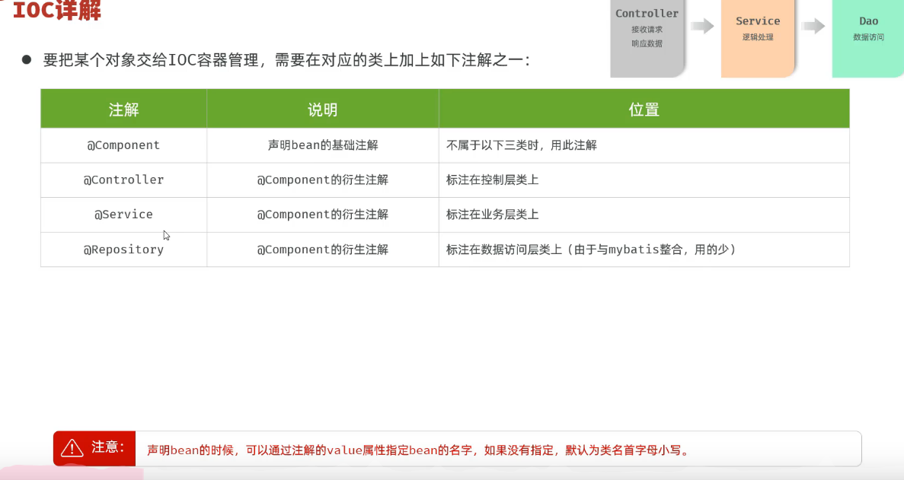
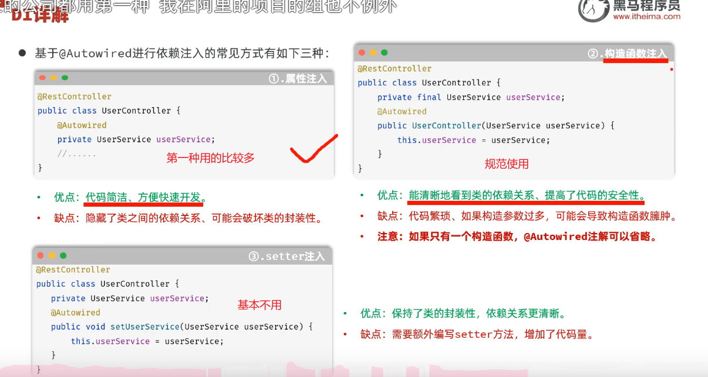
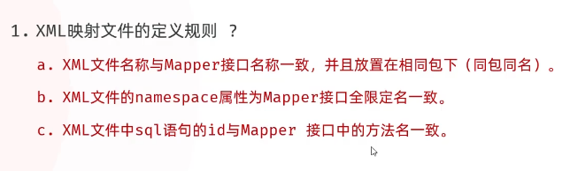

> 学习日期：2026-10-09。

## 一、Spring IoC 与 DI

### 1. IoC（控制反转）



IoC（Inversion of Control）是指将对象的创建和管理交给 Spring 容器，而不是程序员手动使用 `new` 创建对象。

常用注解：

- `@Component`：将类注册为 Spring Bean。
- `@Service`：标记业务层组件。
- `@RestController`：标记 Web 控制层组件。
- `@Mapper`：标记 MyBatis Mapper 接口，由 MyBatis 创建代理对象。

### 2. DI（依赖注入）



DI（Dependency Injection）是指 Spring 自动为对象提供其依赖的其他 Bean。

常见注入方式：

- 字段注入：使用 `@Autowired`。
- 构造器注入：推荐使用。
- Setter 注入：通过 Setter 方法注入依赖。

**构造器注入示例：**

```
private final TaskMapper taskMapper;

@Autowired
public TaskServiceImpl(TaskMapper taskMapper) {
    this.taskMapper = taskMapper;
}
```

知识点：

- `this.taskMapper`：当前对象的成员变量。
- `taskMapper`：构造方法的形参。
- `final`：变量完成初始化后不能重新赋值。
- 只有一个构造方法时，Spring 可以省略 `@Autowired`。

## 二、Service 接口与实现类

### 1. 后端分层结构

```
TaskController
      ↓
TaskService（接口）
      ↓
TaskServiceImpl（实现类）
      ↓
TaskMapper（持久层接口）
      ↓
MySQL
```

### 2. Service 接口

接口负责声明业务方法，不编写具体实现。

```
public interface TaskService {

    List<Task> findAll();

    Task findById(Integer id);

    int createTask(Task task);

    int updateTask(Task task);

    int deleteById(Integer id);
}
```

### 3. Service 实现类

实现类通过 `implements` 实现接口，并调用 Mapper 完成数据库操作。

```
@Service
public class TaskServiceImpl implements TaskService {

    private final TaskMapper taskMapper;

    public TaskServiceImpl(TaskMapper taskMapper) {
        this.taskMapper = taskMapper;
    }

    @Override
    public List<Task> findAll() {
        return taskMapper.findAll();
    }
```

### 4. Java 接口知识复习

- 普通抽象方法默认修饰符：`public abstract`。
- 接口成员变量默认修饰符：`public static final`。
- `implements`：实现接口。
- `@Override`：标记重写方法。
- 实现类重写接口方法时不能降低访问权限。
- 一个接口可以有多个实现类。
- 一个实现类可以实现多个接口。

## 三、Spring 多 Bean 注入与降低耦合

### 1. 多 Bean 问题

当一个接口存在多个实现类 Bean 时，Spring 可能无法确定应该注入哪一个。

例如：

```
TaskService
    ├── TaskServiceImpl
    └── MockTaskServiceImpl
```

### 2. @Primary

指定默认优先使用的 Bean。

```
@Service
@Primary
public class TaskServiceImpl implements TaskService {
}
```

### 3. @Qualifier

指定需要注入的 Bean。

```
public TaskController(
        @Qualifier("taskServiceImpl") TaskService taskService) {
    this.taskService = taskService;
}
```

### 4. 降低耦合的核心思想

- 直接依赖实现类：调用方与具体实现绑定。
- 接口 + `@Qualifier`：依赖接口，但仍指定具体 Bean 名称。
- 接口 + `@Primary`：调用方不必知道默认实现类名称。
- 接口 + 单个实现类：Spring 通常可以自动注入。

**核心结论：降低耦合的关键不是注解本身，而是面向接口编程，将对象创建和实现选择交给 Spring 容器。**

## 四、MyBatis XML 映射

### 1. 注解与 XML 的区别

**注解方式：**

```java
@Select("SELECT * FROM task")
List<Task> findAll();
```

**XML 方式：**

Mapper 接口：

```java
List<Task> findAll();
```

XML 文件：

```java
<select id="findAll"
        resultType="com.campustask.entity.Task">
    SELECT * FROM task
</select>
```

XML 更适合复杂 SQL、动态 SQL 和 SQL 的集中维护。

### 2. XML 映射文件配置

文件位置：

```
src/main/resources/mapper/TaskMapper.xml
```

基本结构：

```java
<?xml version="1.0" encoding="UTF-8" ?>
<!DOCTYPE mapper
    PUBLIC "-//mybatis.org//DTD Mapper 3.0//EN"
    "http://mybatis.org/dtd/mybatis-3-mapper.dtd">

<mapper namespace="">

</mapper>
```

重要属性：

- `namespace`：Mapper 接口的完整类名。
- `id`：Mapper 接口对应的方法名。
- `resultType`：查询结果映射的 Java 类型。

Spring Boot 配置(a开头的)：

```
mybatis:
  mapper-locations: classpath:mapper/*.xml
```

### 3. XML CRUD 标签

| 标签       | 作用 |
| ---------- | ---- |
| `<select>` | 查询 |
| `<insert>` | 新增 |
| `<update>` | 修改 |
| `<delete>` | 删除 |

### 4. 查询操作

```java
<select id="findById"
        resultType="com.campustask.entity.Task">
    SELECT *
    FROM task
    WHERE id = #{id}
</select>
```

`#{id}` 表示参数占位符。

MyBatis 通常通过 JDBC `PreparedStatement` 进行参数绑定，降低 SQL 注入风险。

### 5. 新增操作

```java
<insert id="insert"
        useGeneratedKeys="true"
        keyProperty="id">
    INSERT INTO task (title, type, status, deadline)
    VALUES (#{title}, #{type}, #{status}, #{deadline})
</insert>
```

- `#{title}`：读取传入对象的 `title` 属性。
- `useGeneratedKeys="true"`：获取数据库生成的主键。
- `keyProperty="id"`：将生成的主键回填到对象的 `id` 属性。

### 6. 修改操作

```java
<update id="updateTask">
    UPDATE task
    SET title = #{title},
        type = #{type},
        status = #{status},
        deadline = #{deadline}
    WHERE id = #{id}
</update>
```

### 7. 删除操作

```java
<delete id="deleteById">
    DELETE FROM task
    WHERE id = #{id}
</delete>
```

`insert`、`update`、`delete` 方法返回的 `int` 通常表示受影响的行数。

以上 SQL 使用示例表名及字段，实际开发应与数据库表结构保持一致。

### 8. XML 映射注意事项



- `namespace` 必须与 Mapper 接口完整类名一致。
- XML 的 `id` 必须与接口方法名一致。
- `resultType` 应正确指定查询结果类型。
- Mapper 接口需要被 MyBatis 扫描。
- 同一个方法避免同时配置注解 SQL 和 XML SQL。
- SQL 从注解迁移到 XML 后，Service 层通常不需要修改。

## 六、今日项目总结

### 已完成的代码工作

1. 将 `TaskService` 调整为业务接口。
2. 创建 `TaskServiceImpl` 实现类。
3. 使用构造器注入 `TaskMapper`。
4. 实现任务查询、新增、修改、删除等五个 CRUD 方法。
5. 学习 MyBatis 注解 SQL 向 XML 映射迁移。
6. 整理 GitHub 功能分支提交与推送流程。

### 今日核心收获

1. **IoC**：Spring 管理对象的创建与生命周期。
2. **DI**：Spring 自动为对象提供依赖。
3. **面向接口编程**：降低调用方与具体实现类的耦合。
4. **MyBatis XML**：将 SQL 与 Java 接口分离，提高维护性。
5. **Git 分支管理**：通过 Commit、Push、PR 和 Merge 管理开发成果。
