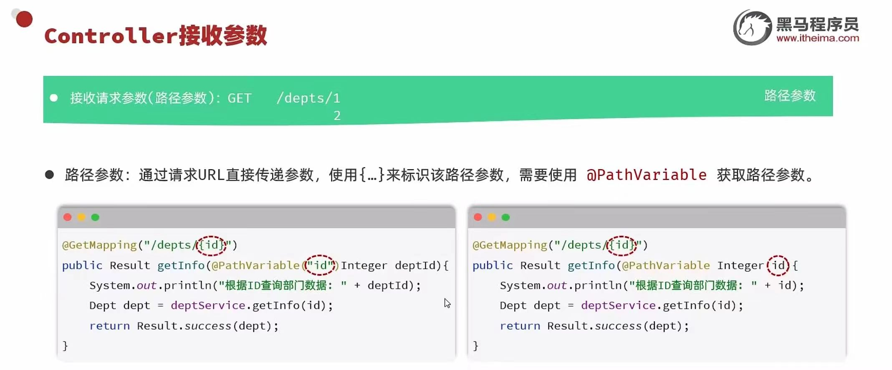
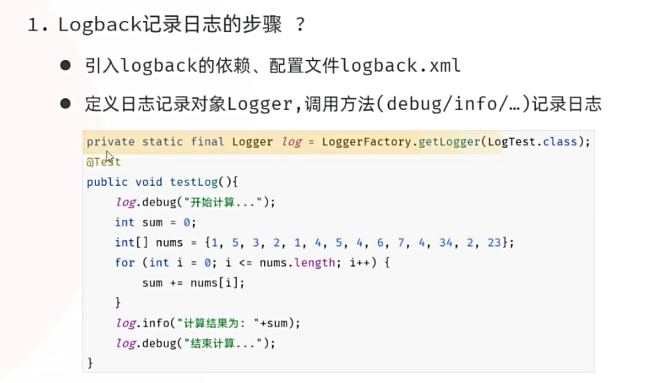

> 学习日期：2026-10-14。

## 查询回显

### 接收路径参数



### 在url中可以携带多个路径参数  如/dept/1/0

```java
public Result getInfo(@PathVariable Interge id,@PathVariable Interge sta){
}
```

## @RequestMapping()注解

放在**类上**的 `@RequestMapping`，为该类下所有方法提供**统一的父路径（前缀）**。

java

```
@Controller
@RequestMapping("/user")           // 父路径
public class UserController {

    @RequestMapping("/list")       // 最终：/user/list
    public String list() { ... }

    @RequestMapping("/save")       // 最终：/user/save
    public String save() { ... }
}
```

最终访问路径 = **类路径 + 方法路径**。

> 类上的 `@RequestMapping` = **该 Controller 的统一前缀（父路径）+ 公共映射规则**，方法上的路径会拼接在它后面形成最终 URL。

## 日志技术


