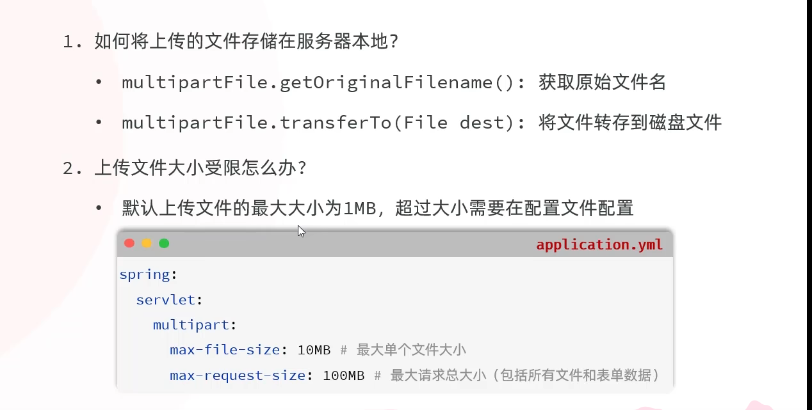

> 学习日期：2026-10-22。

今日学习总结（Java + AI 接口开发）

1. Java 异常处理：掌握 `try/catch`、`throw`、`throws`、`finally` 的作用与区别。
2. AI 接口异常处理：学习处理网络异常、线程中断和 HTTP 错误状态码。
3. AI 结构化输出：通过 `system` Prompt 约束 AI 返回指定格式的 JSON。
4. JSON 转 DTO：使用 Jackson 的 `readTree()` 提取 AI 响应内容，再通过 `readValue()` 转换为 Java 对象。

今日成果： 完成 Java 异常处理课程，初步掌握 AI 自然语言解析为结构化任务数据的流程。

下次学习： AI 输出校验、异常数据处理及任务解析可靠性优化。

**文件上传**

