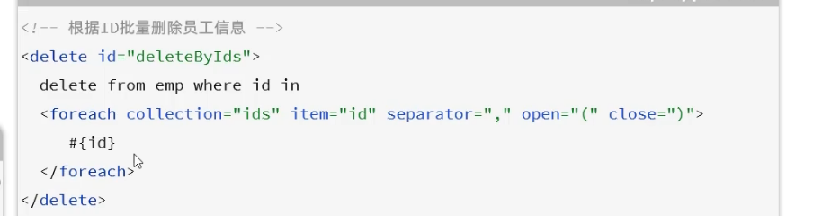
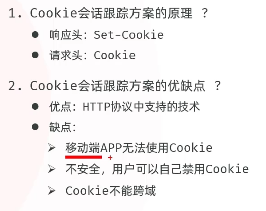
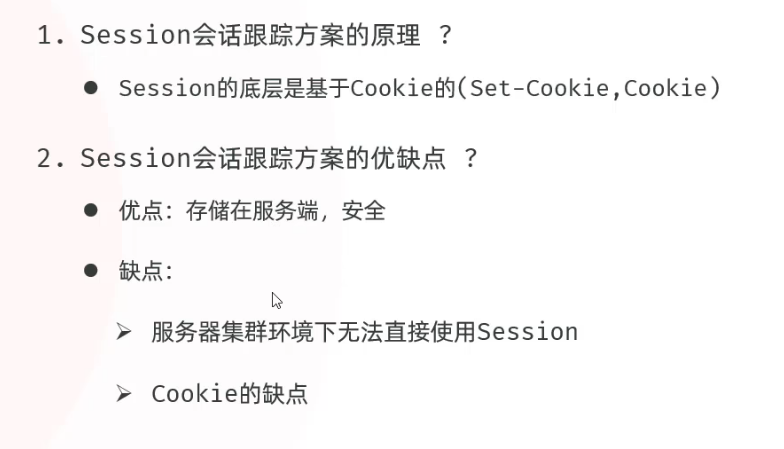
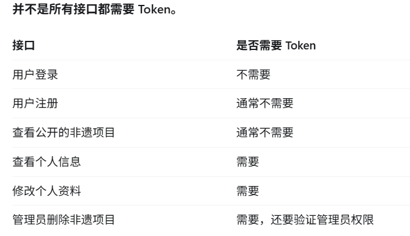

> 学习日期：2026-10-23。

## 事务注解

```java
@Transactional(rollbackFor = Exception.class)
public void transfer() {
    // 1. A账户扣除100元
    accountMapper.decrease(1, 100);

    // 2. B账户增加100元
    accountMapper.increase(2, 100);
}
```

- `@Transactional`：告诉 Spring 对这个方法进行事务管理。

- `rollbackFor`：指定遇到哪些异常时需要回滚。

- `Exception.class`：表示遇到 `Exception` 类型及其子类异常时回滚。

- `{}`：Java 注解中的数组写法，只有一个元素时可以省略。

## 动态SQl——foreach

**作用**：遍历集合或数组，动态拼接 SQL 语句。



| 属性         | 作用                   |
| ------------ | ---------------------- |
| `collection` | 要遍历的集合或数组     |
| `item`       | 每次遍历取出的元素     |
| `separator`  | 元素之间的分隔符       |
| `open`       | 拼接 SQL 的开头        |
| `close`      | 拼接 SQL 的结尾        |
| `index`      | 当前元素的索引（可选） |

## 登录会话

是指用户登录成功后，服务器在一段时间内保持用户登录状态的机制，使用户访问其他页面或接口时不需要重复登录。

基本流程：

1. 用户登录：输入用户名和密码，服务器验证身份。
2. 创建会话：验证成功后，服务器创建 Session，保存用户身份信息。
3. 返回标识：服务器通过 Cookie 将 Session ID（如 `JSESSIONID`）发送给浏览器。
4. 保持登录：浏览器后续请求自动携带 Cookie，服务器根据 Session ID 识别用户。
5. 会话结束：用户退出登录、Session 超时或被服务器主动销毁。

### Session 与 Cookie 的区别

| 对比     | Session           | Cookie                 |
| -------- | ----------------- | ---------------------- |
| 存储位置 | 服务器端          | 浏览器端               |
| 主要作用 | 保存会话状态      | 保存少量数据或会话标识 |
| 典型内容 | 用户 ID、登录状态 | Session ID             |

### Cookie（了解就行）



### Session（了解就行）



### 令牌（Token）

是服务器颁发给客户端的一种身份凭证，用于证明用户已经登录。

可以把它理解为一张“通行证”：

- 登录成功：服务器颁发 Token。
- 访问接口：客户端携带 Token。
- 服务器验证：Token 合法，才允许访问受保护的资源。

**核心作用**：身份认证，避免用户每次请求都重新输入账号密码。


注意：



**特别注意**：登录接口通常不需要 Token，登录成功后访问受保护的接口才需要携带 Token。
