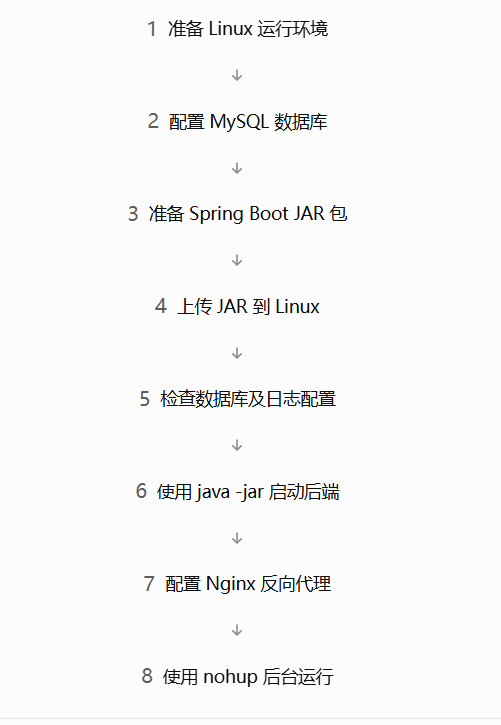
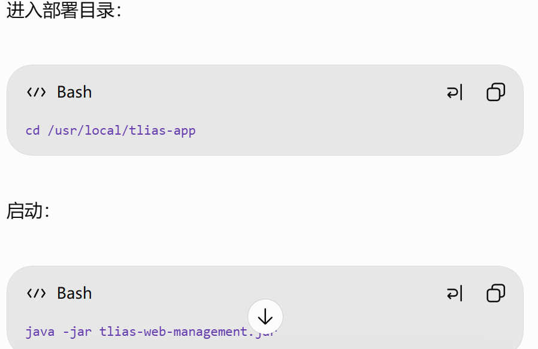

> 学习日期：2026-10-29。

## 启动与停止nginx

**前提：**进入nginx的根目录


```bash
#启动nginx
sbin/nginc 

#停止
sbin/nginc -s quit

#重新加载
sbin/nginc -s reload
```

## 后端部署



### 1.准备 Linux 环境

确保 Linux 已安装 JDK、MySQL，并且网络正常

### 2.配置 MySQL

### 3.检查 JAR 中的配置文件

### 4.准备并上传 JAR 包

### 5.前台启动 Spring Boot



检查 8080 端口：

```
ss -lntp | grep 8080
```

### nohup 后台运行（重点）

```
nohup java -jar tlias-web-management.jar > tlias-console.log 2>&1 &
```

**后台服务管理**

```
# 查看进程
ps -ef | grep '[t]lias-web-management.jar'

# 查看实时日志
tail -f tlias-console.log

# 查看端口
ss -lntp | grep 8080

# 停止进程
kill PID
```
