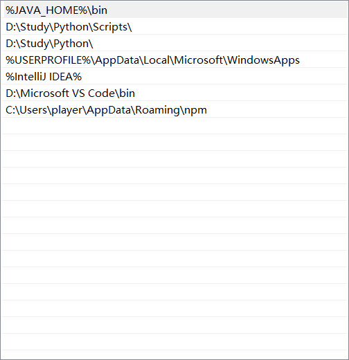

## java原理

### 1.运行机制

```java
.java-编译->.class -运行-> (JVM)虚拟机
```

### 2.内存

栈：方法

堆：new关键字

方法区：字节码文件

> 基本数据类型在内存中的特点：
>
> 记录的是真实的数据，传递的也是真实的数据
>
> 引用数据类型在内存的特点：
>
> 记录的是地址值，传递的也是地址值

## 环境变量

1.找到对应jdk的bin文件地址

2.系统和用户都可以分别新建一个变量JAVA_HOME


3.用户变量里的path里面



4.系统变量中的path


