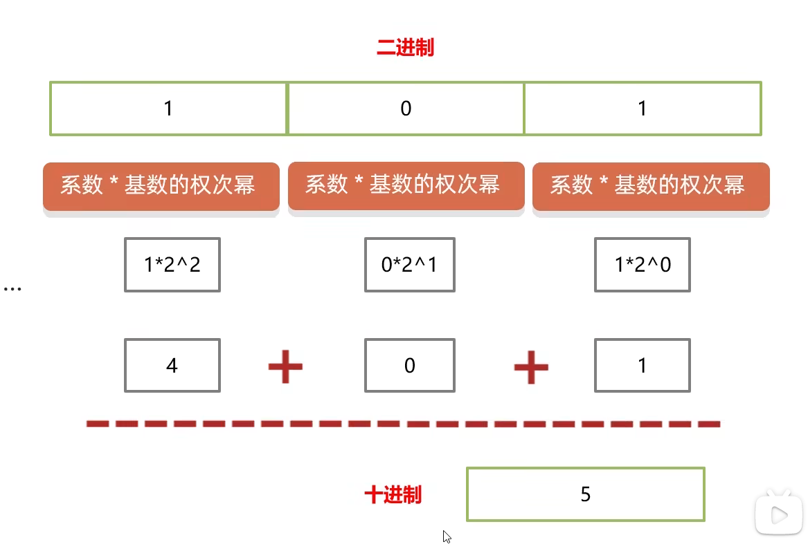
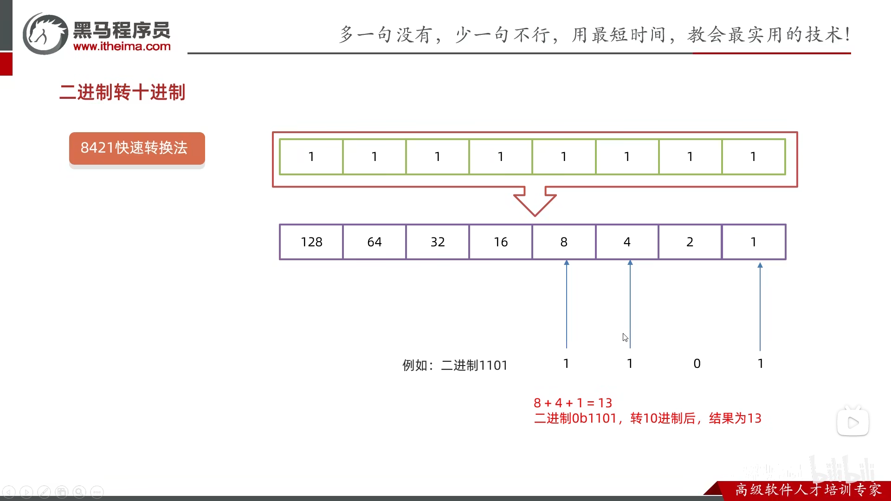
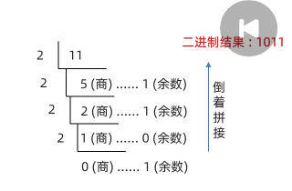
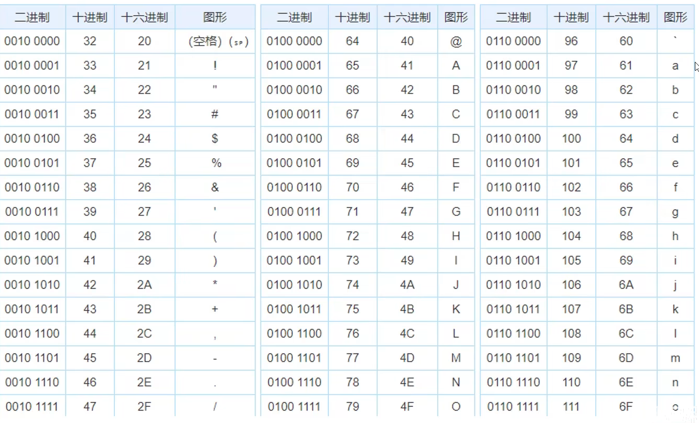
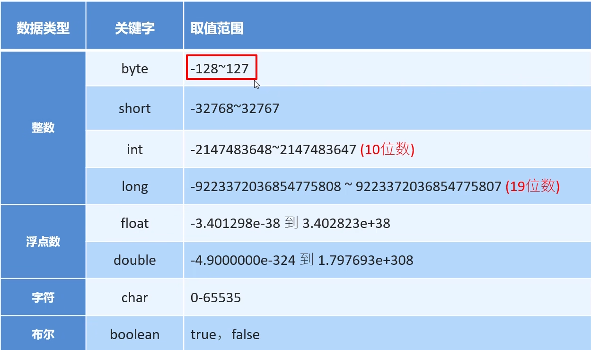

## 1.注释

### 1.1注释分类

- **单行注释:**//注释信息
- **多行注释:**/* 注释信息 * /
- **文档注释:**/** 注释信息 * /

> - 文档注释暂时用不上。
> - 写注释不要嵌套。

## 2.关键字

### 2.1关键字的含义

- **被Java赋予了特点涵义的英文单词**

### 2.2关键字特点

- 关键字的字母**全部小写**。
- 常用的代码编辑器，针对关键字有特殊的颜色标记。

> class:定义一个类
>
> package：表示当前类的定义在那个包下

## 3.字面量

### 3.1字面量的分类

| 字面量类型 |              说明               |          举例          |
| :--------: | :-----------------------------: | :--------------------: |
|  整数类型  |        不带小数点的数字         |        666，-88        |
|  小数类型  |         带小数点的数字          |      13.14,-5.20       |
| 字符串类型 |      用双引号括起来的内容       | “HelloWorld” , ”嘿嘿”  |
|  字符类型  | 用单引号括起来的,内容只能有一个 |    ‘A’,  ’0’ ,’我’     |
|  布尔类型  |         布尔值,表示真假         | 只有两个值: true,false |
|   空类型   |        一个特殊的值,空值        |       值是 null        |

> - null是不能直接打印的!
>
>   如果我们要打印null,那么只能用字符串的形式进行打印
>
>   ```java
>   System.out.println("null");
>   ```

**扩展点:特殊字符**

- \t  制表符

## 4.变量

### 4.1变量的定义格式

**数据类型 变量名 =数据值；**

### 4.2变量的使用方式

- 输出打印

```java
int a=10;
System.out.println(a);//10
```


- **参与计算**

```java
int a=10;
int b=10;
System.out.println(a+b);//20
```


- **修改记录的值**

```java
int a=10;
System.out.println(a);//10
a=20;
System.out.println(a);//20
```

> **变量的注意事项：**
>
> 1. 只能存一个值  
> 2. 变量名不允许重复定义
> 3. 一条语句可以定义多个变量
> 4. 变量在使用之前一定要进行赋值
> 5. 变量的作用域范围

## 5.计算机的存储规则

**在计算机中,任意数据都是以**二进制**的形式来存储的**

### 5.1进制

十进制: 逢十进一 借一当十

**二进制: 逢二进一  借一当二**

#### 5.1.1常见的进制

- 二进制:由0和1组成, 代码中以****0b****开头

- 十进制:由0~9组成, 前面不加任何前缀

- 八进制:由0~7组成,代码中以****0****开头

- 十六进制:由0~9还有a~f组成,代码中以****0x****开头

#### 5.1.2 进制的转换

1. **任意进制转十进制**

   **系数* 基数的权次幂 相加**

**系数:**就是每一位上的数

**基数:**当前进制数

**权:**从右往左.依次为 0 1 2 3 4..



**2.二进制转十进制**




**3.十进制转其他进制**

- 除基数余法

  不断的除以基数(转几进制,基数就是几)得到余数,直到商为0,再将余数倒着拼起来即可!!

  

### 5.2 ASCII码表



## 6.数据类型

数据类型  **变量名** = 数据值;

### 6.1数据类型的分类

1. 基本数据类型
2. 引用数据类型

#### 6.1.1基本数据类型



> - **定义long类型变量时,在数据值后面需要加一个L(大小写都可以)作为后缀**
>
> - **定义float类型变量时,数据值也需要加一个F作为后缀**
>
> - **整数和小数取值范围大小关系:**
>
>   ****double>float>long>int>short>byte****
>
> - 小数参与计算可能不精确
>
> - byte和short类型的数据需先提升为int类型

## 7.标识符

**含义: 就是给**类, 方法,变量**等起的名字**

### 7.1标识符命名规则

**硬性规则**

- 由数字,字母,下划线,和**美元符$**组成
- 不能以数字开头
- 不能是关键字
- 区分大小写

**软性规则:**

- 小驼峰命名法(方法,变量):
  - 标识符是一个单词,全部小写—-name
  - 标识符是多个单词,第一个单词全部小写,其他单词首字母大写—–firstName
- 大驼峰命名法(类名):
  - 标识符一个单词.首字母大写—–Student
  - 标识符是多个单词,每个单词首字母大写——GoodStudent

> 标识符应**见面知意!**

## 8.Scanner键盘录入

**介绍:**

**Java帮我们写好了一个类叫Scanner,这个类就可以接收键盘输入的数字**

- 步骤一:导包—- Scanner这个类在哪

```java
import java.util.Scanner; //导包的动作必须出现在类定义的上边
```


- 步骤二:创建对象—- 表示我们要开始用Scanner这个类了

```java
Scanner sc = new Scanner(System.in); 
//sc是变量名,可以变,其他的不允许
```


- 步骤三:接收数据—– 真正开始干活了

```java
int i = sc.nextInt();//i是变量名,可变,其他的不可变

  
int num = sc.nextInt();

System.out.println("个位:" + (num % 10));
System.out.println("十位:" + (num / 10 % 10));
System.out.println("百位:" + (num / 100));
```

> **第一套体系:**
>
> nextInt( );接收整数
>
> nextDouble( );接收小数
>
> next( );接收字符串
>
> **遇到空格,制表符,回车就停止接收,这些符号后面的数据就不会接收了**
>
> **第二体系:**
>
> nextLine( );接收字符串
>
> **可以接收空格,制表符,遇到回车才停止接收数据**
>
> **键盘录入的两套 体系不能混用的**
