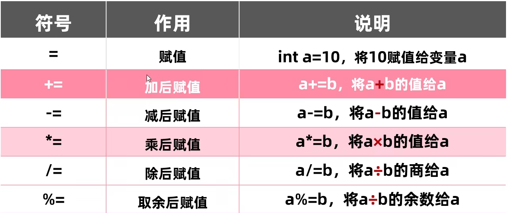
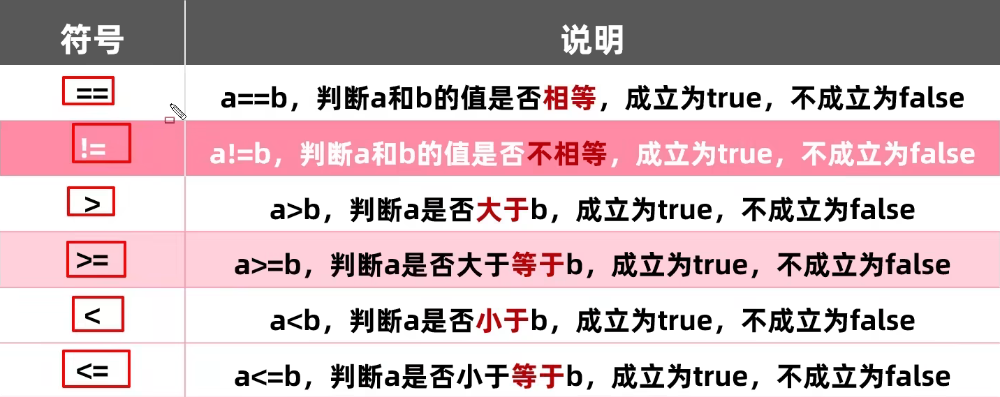
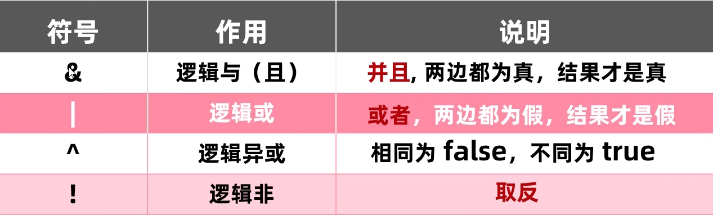
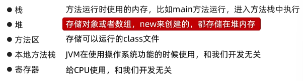

## 二.运算符

### 1.算数运算符

| 符号 |   作用    |
| :--: | :-------: |
|  +   |    加     |
|  -   |    减     |
|  *   |    乘     |
|  /   |    除     |
|  %   | 取模,取余 |

> 取模应用场景:
>
> - 可以用来判断,A是否可以被B整除
>
>   **A%B为0时 说明A可以被B整除**
>
> - 可以判断A是否为偶数
>
>   **A%2  如果结果为0,那么证明A是一个偶数,如果结果为1,那么证明A是个奇数**
>


### 1.1 ”+” 操作的三种情况

- **数字相加** 
  - 数据类型不一样,不能进行计算,需要转成一样的才可以进行计算

****double>float>long>int>short>byte****

**一.隐式转换:把取值范围小的数值,转换为取值范围大的数据**

1. 取值范围小的,和取值范围大的进行运算,小的会先提升为大的,再进行运算
2. byte short char 三种类型的数据在运算的时候,都会直接先提升为int,然后再进行运算

**二.强制转换:如果把一个取值范围大的数值,赋值给取值范围小的变量,是不允许直接赋值的,如果一定要这么做就需要加入强制转换**

格式: 目标数据类型 变量名=(目标数据类型)被强转的数据;

```java
double a=13.14;
int b=(int) a; //b=13
```

- **字符串相加**

  - 只要有字符串参与,“+”是字符串连接符,而不是算术运算符了,**会将前后的数据进行拼接**,并产生一个新的字符串

  ```java
  "123"+123="123123"
  ```

  - 连续进行“+”操作时,从左往右逐个执行

  ```java
  1+9+"hahah"="10hahah"
  1+9+"haha"+1+9="10haha19"
  ```

  

- **字符相加**

字符a在ASCII码中对应97

字符A在ASCII码中对应65

**当字符+字符/字符+数字时,会把字符通过ASCII码表查询到对应的数字再进行计算**

```java
        System.out.println('a'+1);//98
        System.out.println("abc"+'a');//abca
```

### 2.自增自减运算符

- ++在后,先用后加( - -同理)

```java
int a=10;
int b=a++;//b=10 
```

- ++在前,先加后用( - -同理)

```java
int a=10;
int b=++a;//b=11 
```

### 3.赋值运算符

**分类**


> 以上底层都隐藏了一个强制类的转换

### 4.关系运算符

**分类**



### 5.逻辑运算符

**分类**



> 短路与  &&
>
> 短路或  || 

#### 6.三元运算符

```java
//格式 ：关系表达式? 表达式1:表达式2;
```

#### 7.优先级(高到低)

| 优先级 | 运算符                                                       | 描述                             | 结合性  |
| :----- | :----------------------------------------------------------- | :------------------------------- | :------ |
| 1      | `++` `--`                                                    | 后置自增/自减                    | 右 → 左 |
| 1      | `()` `[]` `.`                                                | 方法调用、数组下标、对象成员访问 | 左 → 右 |
| 2      | `++` `--`                                                    | 前置自增/自减                    | 右 → 左 |
| 2      | `+` `-` `!` `~`                                              | 一元正/负、逻辑非、按位取反      | 右 → 左 |
| 3      | `()`                                                         | 强制类型转换                     | 右 → 左 |
| 4      | `*` `/` `%`                                                  | 乘、除、取模                     | 左 → 右 |
| 5      | `+` `-`                                                      | 加、减                           | 左 → 右 |
| 6      | `<<` `>>` `>>>`                                              | 左移、右移、无符号右移           | 左 → 右 |
| 7      | `<` `>` `<=` `>=` `instanceof`                               | 关系运算符、类型检查             | 左 → 右 |
| 8      | `==` `!=`                                                    | 相等性比较                       | 左 → 右 |
| 9      | `&`                                                          | 按位与、逻辑与（非短路）         | 左 → 右 |
| 10     | `^`                                                          | 按位异或、逻辑异或               | 左 → 右 |
| 11     | `\|`                                                          | 按位或、逻辑或（非短路）         | 左 → 右 |
| 12     | `&&`                                                         | 短路逻辑与                       | 左 → 右 |
| 13     | `\|\|`                                                         | 短路逻辑或                       | 左 → 右 |
| 14     | `? :`                                                        | 三元条件运算符                   | 右 → 左 |
| 15     | `=` `+=` `-=` `*=` `/=` `%=` `&=` `\|=` `^=` `<<=` `>>=` `>>>=` | 赋值及复合赋值                   | 右 → 左 |

## 三.取位数的公式

**取每个位数上的数:**

i是一个三位数;

**个位数:**     **ge=i%10**

**十位数:**     **shi=i/10%10**

**百位数:**       **bai=i/100%10**

**n位数**:       **n=n/n%10**


## 四.Java内存分配


