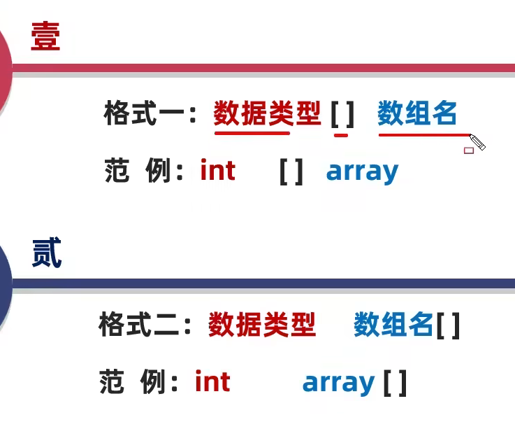
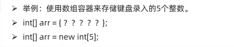

## 1. 数组的含义

- 数组指的是一种容器,可以用来存储**同种数据类型**的多个值
  - 数组容器在存储数据的时候,需要结合隐式转换考虑


## 2.数组的定义与静动态初始化

### 2.1数组的定义



### 2.2数组初始化的两种方式

- 静态初始化

  - 初始化:就是在内存中,为数组容器开辟空间,并将数据存入容器中的过程
  - 格式:  ==数据类型[] 数组名 = {元素1,元素2,元素3…};==
  - 范例: int[] array={3,5,7};

  ​                 double[]  array2={2.2,11.2,22.4};

  

### 2.3 数组元素访问

- 格式: **数组名[索引];**

  - 索引:也叫下标,角标
  - 索引的特点:  从0开始,逐个+1增长,连续不间断

  ```java
  //把数据存储到数组中
  //格式: 数组名[索引] = 具体数据/变量;
  int array[] = {1,3,4,6,7}
  array[0] = 12;
  System.out.println(array[0]);//输出12
  ```

### 2.4 数组遍历

```java
 int arr[] = {12,23,34,5,67,46};
        //利用循环遍历数组
        //开始条件:0
        //结束条件:数组的长度 - 1(最大索引)
        for (int i = 0; i <arr.length ; i++) {
            System.out.println(arr[i]); 
            //arr[i]依次代表数组里的每一个元素
            }
```

### 2.5 数组的动态初始化

- 初始化时只指定数组长度,由系统为数组分配初始值
- 格式:**数据类型[]  数组名= new 数据类型[数组长度];**
  - 范例: int[] array=new int[3];

> 数组默认初始化值的规律
>
> - 整数类型: 默认初始化值0
> - 小数类型: 默认初始化值0.0
> - 字符类型 :默认初始化值 ‘/u0000’ 空格
> - 布尔类型: 默认初始化值 false
> - 引用数据类型:  null

### 2.6 数字动态初始化和静态初始化的区别

- 动态: 手动指定数组**长度**,由系统给出默认初始化值

  -  只明确元素个数 ,不明确具体数值时使用

  

- 静态: 手动指定数组**元素**,系统会根据元素个数,计算出数组的长度

## 3.数组常见问题

当访问了数组中不存在的索引,就会引发索引越界异常

> 避免问题就应该牢记索引的范围
>
> - 最小索引: 0
> - 最大索引: 数组长度-1
