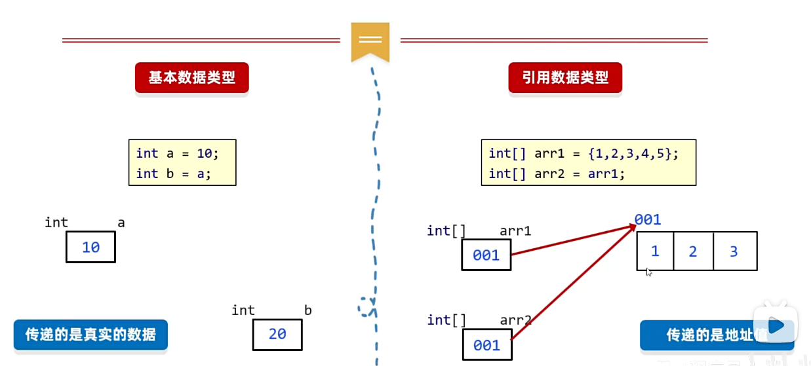

**方法是程序中最小的执行单元**

## 1.有返回值的方法定义格式

```java
public static 返回值类型 方法名(参数){
     方法体;
     return 返回值;
 }
/*return: 和循环没有关系,跟方法有关,表示结束方法和返回结果
如果方法执行到了return,那么整个方法都结束,里面的循环也会随之结束
 break: 和方法没有关系,跟循环有关,表示结束循环或者switch的
*/

```

> 方法的注意事项
>
> 1. 函数与函数之间是平级关系，不能嵌套
> 2. return下面，不能写代码，永远执行不到
> 3. 方法的返回值为void，表示没有返回值，return可以省略不写
> 4. 方法的编写顺序和执行顺序无关

## 2.有返回值方法的调用格式

直接调用,赋值调用,输出调用

## 3.方法的重载

- 同一个类中,方法名相同,参数不同的方法 。与返回值无关
- 参数不同:个数不同,类型不同,顺序不同

## 4.方法传递参数的结论


