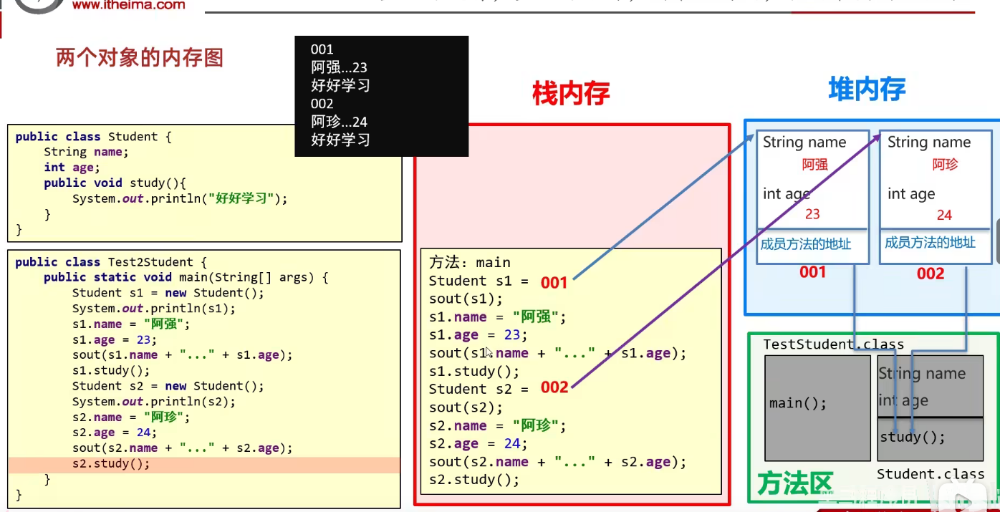
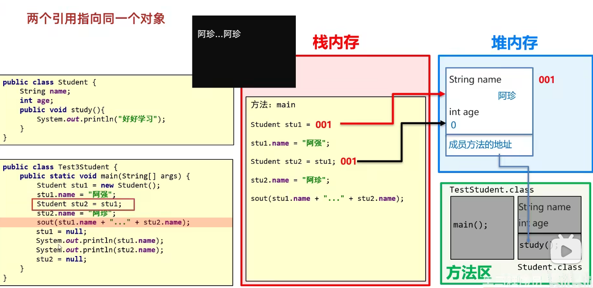
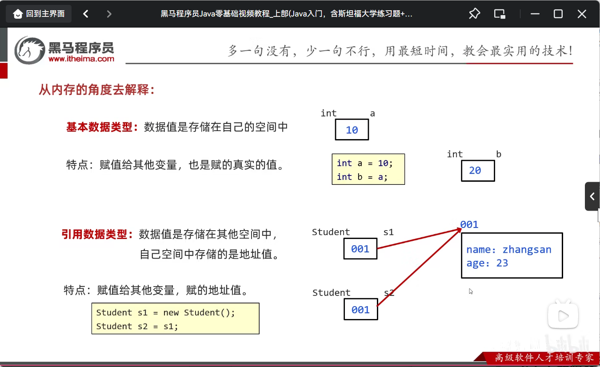
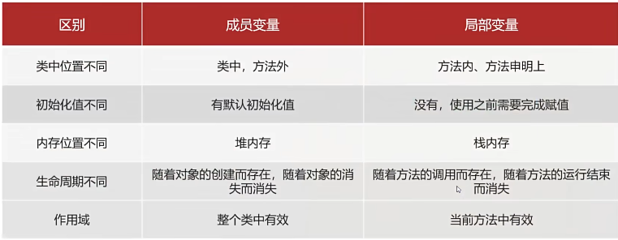
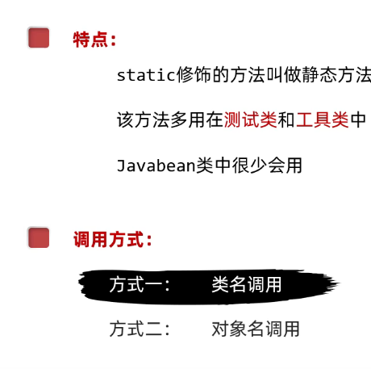
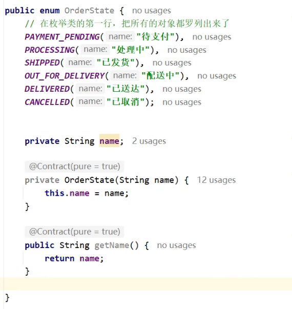
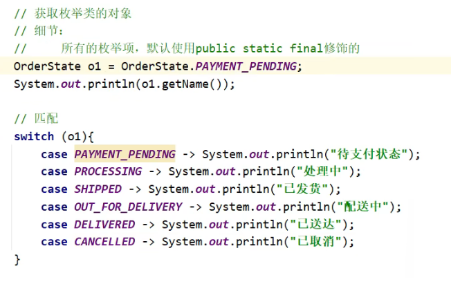

- 重点学习
  1. 学习获取已有对象并使用
  2. 学习如何自己设计对象并使用

## 1.类和对象

- 类（设计图）：是对象共同特征的描述
- 对象：是真实存在的具体对象

**在java中，必须先设计类，才能获取对象**


### 1.1如何定义类

```java
public class 类名{
    /*
    1.成员变量（代表属性，一般是名词）
    2.成员方法（代表行为，一般是动词）
    3.构造器
    4.代码块
    5.内部类
    */
}
```


```java
public class Phone{
    //属性
    String brand;
    double price;
    //行为
    public void call(){
        System.out.println("打电话");
    }
}
```

### 1.2 如何得到类的对象

```java
类名 对象名 =new 类名( );
Phone  p   =new Phone( );
```

### 1.3如何使用对象

- 访问属性： 对象名.成员变量
- 访问行为：对象.方法名(…)

```java
public class Phonetest {
    public static void main(String[] args) {
        //创建Phone对象
        Phone p=new Phone();
        //给手机赋值
        p.brand="小米";
        p.price=4599;
        //获取手机对象的值
        System.out.println(p.brand);
        System.out.println(p.price);
        //调用手机的方法
        p.call();
        /*输出
小米
4599.0
打电话
*/
    }


}
```

## 2.定义类的补充注意事项

- 用来描述一类事物的类，专业叫做：**javabean类**

  在javabean类中，是不写main方法的

- 在以前，编写main方法的类，叫做**测试类**

  我们可以在测试类中创建javabean类的对象并进行赋值调用

- 类名首字母建议大写且需要见名知意，驼峰命名

- 成员变量(代表属性)的完整格式是：**修饰符 数据类型 变量名称 = 初始化值**；一般无需指定初始化值，存在默认值

### 2.1封装

对象代表什么，就得封装对应的数据，并提供数据对应的行为

### 2.2private关键字

- 是一个权限修饰符
- 可以修饰成员（成员变量和成员方法）
- 被private修饰的成员只能在本类中才能访问
- 如果需要被其他类使用，提供相应的操作，提供get和set方法

> 针对于每一个私有化的成员变量，都要提供get和set方法
>
> set方法：给成员变量赋值
>
> get方法：对外提供成员变量的值
>
> **this的作用：可以区分成员变量和局部变量  this.age就表示成员变量中的age**

### 2.3构造方法的格式

```c
public class Student{
    
    修饰符 类名(参数){
        方法体;
    }
}
```

**特点**

1. 方法名和类名相同，大小写也要一致
2. 没有返回值类型，连void都没有
3. 没有具体的返回值(不能由return带回结果数据)

**执行机制**

1. 创建对象的时候由虚拟机调用，不能手动调用构造方法
2. 每创建一次对象，就会调用一次构造方法

 **构造方法注意事项**

1. 构造方法的定义
   - 如果没有定义构造方法，系统将给出一个默认的无参构造方法
   - 如果定义了构造方法，系统将不再提供默认的构造方法
2. 构造方法的重载
   - 带参构造方法，和无参数构造方法，两者方法名相同，但参数不同，这叫做构造方法的重载
3. 推荐使用方式
   - **无论是否使用，都手动书写无参数构造方法和带全部参数的构造方法**

## 3.标准的javaBean类

1. 类名需要见名知意
2. 成员变量使用**private**修饰
3. 提供至少两个构造方法
   - 无参构造方法
   - 带全部参数的构造方法
4. 成员方法
   - 提供每个成员变量对应的set方法和get方法
   - 如果还有其他行为，也需要写上

> idea中可下载一个插件ptg可以自动生成标准的javaBean格式

## 4.两个对象的内存图



**两个引用指向同一个对象**



## 5.基本数据类型和引用数据类型

**从内存的角度去解释:**



###6.this的内存原理

**this的作用:区分局部变量和成员变量**

**this的本质:代表方法调用者的地址值**

## 7.成员变量和局部变量

成员变量和局部变量的区别



## 8.static关键字

### 修饰成员变量

静态变量，被当类所有的对象**共享**

**共享**：赋值只要赋值一次，只要有一个对象修改了静态变量，其他对象再次访问的时候就是修改之后的结果了

### 修饰成员方法



```java
修饰符 static 返回值类型 方法名(参数列表) {
    // 方法体
}

public class MyTools {
    
    // 示例1：无参数、无返回值的静态方法
    public static void printHello() {
        System.out.println("Hello, World!");
    }
    
    // 示例2：有参数、有返回值的静态方法
    public static int add(int a, int b) {
        return a + b;
    }
    
    // 示例3：private 静态方法（仅类内部使用）
    private static String formatMessage(String msg) {
        return "[INFO] " + msg;
    }
    
    // 示例4：带泛型的静态方法（进阶）
    public static <T> void printArray(T[] array) {
        for (T item : array) {
            System.out.print(item + " ");
        }
        System.out.println();
    }
}


//调用方法
public class Test {
    public static void main(String[] args) {
        // 方式一：通过类名调用（推荐）
        MyTools.printHello();          // 输出：Hello, World!
        int sum = MyTools.add(3, 5);   // sum = 8
        
        // 方式二：通过对象调用（不推荐，会有警告）
        MyTools tools = new MyTools();
        tools.printHello();            // 可以运行，但IDE会提示"不应通过实例访问静态成员"
    }
}
```


> - **静态方法属于类本身**，在类加载时就已经分配好内存，可以直接通过`类名.方法名()`调用。
> - **非静态方法（实例方法）属于具体的对象**，必须先创建对象，才能通过`对象.方法名()`调用。

## 9.final关键字

**表示最终，不可变。**可以修饰变量（叫做**常量**），类（不可被继承），方法

1. 只能赋值一次，数据不可变
2. 名字大写。多个单词下划线隔开

```java
final int number =100;

```

> 修饰**基本数据类型**时，变量里的数据无法发生改变
>
> 修饰**引用数据类型**时，内存地址不可改变，但是对象里的属性值可以发生改变，除非属性值也加上final就不可以发生改变

## 10.枚举

**枚举是一个特殊的javaBean类，这个类的对象是有限个**

```java
public enum 枚举类名{
    枚举项1， 枚举项2， 枚举项3；
    属性
    行为
}
```

**枚举类**



**调用枚举类的对象**



> 注意：
>
> 1.每一个枚举项，都是该，枚举类的对象，每一个对象都是通过构造方法创建出来的
>
> 2.枚举项在底层其实就是常量，默认用public static final 修饰
>
> 3.枚举类的第一行必须是枚举项，且要用逗号隔开，分号作为结尾
>
> 4.枚举类的构造方法默认是private，不让外界创建对象
>
> 5.编译器会给枚举类新增两个默认存在的方法:value(),valueOf()
>
> values():表示获取本类中所有的枚举项
>
> valueOf():表示获取一个指定的枚举项
