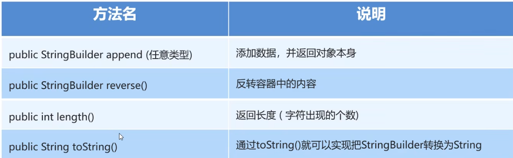

## 1.String

### String的注意点

字符串的内容是不会发生改变的，它的对象在创建后不能被更改

```java
String s = "hello";
//理解为 s ─────→ "hello"
s = "world";

//不是把 "hello" 对象修改成 "world"，而是：
原来：
s ─────→ "hello"

后来：
          "hello"
s ─────→ "world"
```

> `String` 一旦创建，其内容不能被修改；所谓“修改字符串”，通常是产生新的字符串，然后让引用指向新字符串。

### 1.1创建String对象的两种方式

1. 直接赋值
2. new

> 当使用双引号直接赋值时，系统会检查该字符串在串池中是否存在。
>
> 不存在：创建新的
>
> 存在：复用

### 1.2字符串比较：`==` 和 `equals()`

​	**==号比的到底是什么？**

- 基本数据类型：比较的是数据值
- 引用数据类型：比较的是地址值

```java
//注意的是new出来的
String s1 = new String("abc");
String s2 = new String("abc");
```

此时

```
s1 → String对象①："abc"
s2 → String对象②："abc"
```

用`==`判断

```java
s1 == s2 //输出false
```

> 比较的是地址值：是否指向同一个对象。

用`equals`判断

```java
s1.equals(s2)//输出true
```

> `String` 已经重写了 `equals()`，比较字符串内容。

### String常用方法

```java
String s = "Hello Java";
```

长度：

```java
s.length();
```

获取某个位置字符：

```java
s.charAt(0);
```

结果：

```
'H'
```

判断是否包含：

```java
s.contains("Java");
```

判断开头：

```java
s.startsWith("Hello");
```

判断结尾：

```java
s.endsWith("Java");
```

查找位置：

```java
s.indexOf("Java");
```

截取：

```java
s.substring(6);
```

或者：

```java
s.substring(0, 5);
```

注意：

```java
substring(begin, end)

包含 begin
不包含 end
```

也就是经典的：

```java
[begin, end)
```

替换：

```java
s.replace("Java", "Spring");
```

去除首尾空白：

```java
s.trim();
```

以后也会经常看到：

```java
s.isEmpty();
s.isBlank();
```

区别简单记：

```java
"".isEmpty()     → true
"   ".isEmpty()  → false

"".isBlank()     → true
"   ".isBlank()  → true
```

`isBlank()` 会把“只有空白字符”也视为空白字符串。

### String 的切割 `split()`

例如：

```java
String s = "Java,MySQL,Spring";
```

按照 `,` 切：

```java
String[] arr = s.split(",");
```

得到：

```java
arr[0] → "Java"
arr[1] → "MySQL"
arr[2] → "Spring"
```

注意：

> `split()` 的参数是**正则表达式**。

所以以后某些特殊字符不能直接切，要考虑正则转义。

## 2.StringBuilider

**概念:可以看成是一个容器,创建之后里面的内容是可变的**

> 使用StringBulider的场景:
>
> 1.字符串的拼接
>
> 2.字符串的反转



```java
StringBuilder sb=new StringBuilder("h");
        System.out.println(sb);//h
        sb.append(123);
        System.out.println(sb);//h123
        sb.reverse();
        System.out.println(sb);//321h
        int len=sb.length();
        System.out.println(len);//4
     
//将StingBuilder类型转换为String字符串
        String str=sb.toString();
        System.out.println(str);
```

## 3.StringJoiner

- 概述：StringJoiner跟StringBulider一样，也可以看成是一个容器，创建之后里面的内容是可变的
- 作用：提高字符串的操作效率，而且代码编写特别简洁，但是目前市场上很少有人用

### **StringJoiner构造方法**

|                      方法名                       |                             说明                             |
| :-----------------------------------------------: | :----------------------------------------------------------: |
|           public StringJoiner(间隔符号)           |       创建一个StringJoiner类对象，指定拼接时的间隔符号       |
| public StringJoiner(间隔符号，开始符号，结束符号) | 创建一个StringJoiner类对象，指定拼接时的间隔符号，开始符号，结束符号 |

### **StringJoiner成员方法**

|               方法名                |                    说明                    |
| :---------------------------------: | :----------------------------------------: |
| public StringJoiner add(添加的内容) |          添加数据，并返回对象本身          |
|         public int length()         |          返回长度(字符出现的个数)          |
|      public String toString()       | 返回一个字符串(该字符串就是拼接之后的结果) |

## 字符串原理

- 字符串存储的内存原理

  - 直接赋值会复用字符串常量池中的
  - new出来不会复用，而是开辟出一个新的空间
- ==号比的到底是什么？

  - 基本数据类型比较数据值
  - 引用数据值比较地址值

  String
  → 表示字符串

  StringBuilder
  → 高效地修改/拼接字符串

  StringJoiner
  → 按指定分隔符拼接多个字符串
