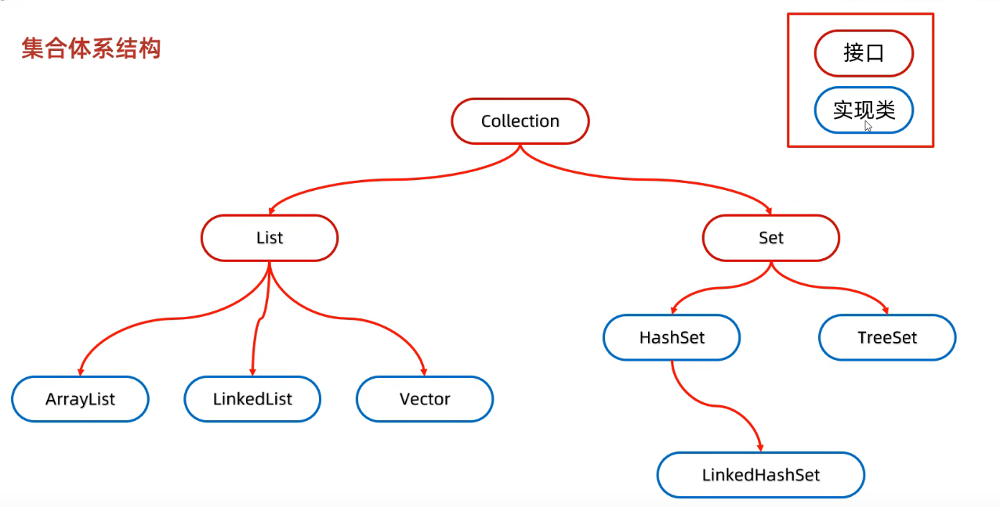
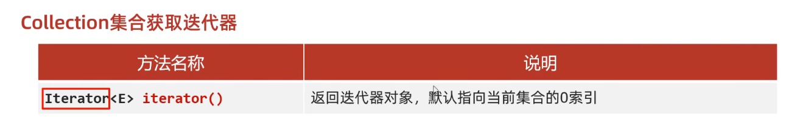
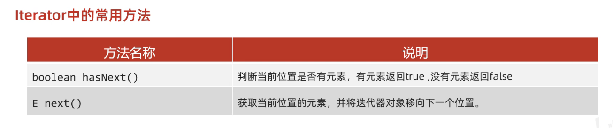

集合**长度可变**,只能存储引用数据类型,存基本数据类型需要对其进行包装类。

## 集合进阶



```
Collection
   ↓
遍历方式
   ↓
List（有序，可重复，有索引）
   ├── ArrayList
   └── LinkedList
   ↓
Set（无序，不重复，无索引）
   ├── HashSet
   ├── LinkedHashSet
   └── TreeSet
   ↓
Map
   ├── HashMap
   └── TreeMap
   ↓
Collections 工具类
```

## Collection

`Collection` 是很多**单列集合**共同的顶层接口之一。

```
                Collection //接口
                /        \
              List       Set // //接口
             /   \        |
     ArrayList LinkedList HashSet  //实现类
```

例如

```java
ArrayList<String> list = new ArrayList<>();

//下面也合法
Collection<String> c = new ArrayList<>();

//因为
ArrayList
   ↓ 实现
List
   ↓ 继承
Collection
    

```

### 作用

因为不同集合虽然底层结构不同，但都有很多共同操作。

```
添加
删除
判断是否存在
判断是否为空
获取元素数量
清空
```

### **常见方法**

```java
Collection<String> c=new ArrayList();
//1.添加元素
//返回值细节：往List系列集合添加元素时，因为允许重复故永远为true。而往Set系列集合中，已存在的元素则返回false，表示添加失败
c.add("Java");

//2.删除
//细节：共性方法，不能通过索引删除
c.remove("Java");

//3.判断元素是否包含
c.contains("Java");

c.size();

c.isEmpty();

//清空
c.clear();

```

> 注意：
>
> Collection是一个接口，我们不能直接创建他的对象。
>
> 只能创建他的实现类来调用它的方法
>
> 实现类：ArrayList

### **contains()与equals()的关系**

```java
Collection<String> c = new ArrayList<>();

c.add("Java");

System.out.println(c.contains("Java"));//输出true
```

但如果集合里面放的是自定义对象：

```java
Collection<Student> c = new ArrayList<>();
Student s1 = new Student("张三", 20);
c.add(s1);
Student s2 = new Student("张三", 20);

c.contains(s2);//涉及到Student 有没有正确重写 equals()
```

> 如果存的是自定义对象，没有重写equals方法，那么默认使用Object类中的equals方法进行判断：依赖地址值进行判断

### 遍历方式

掌握：

```
① Iterator 迭代器
② 增强 for
③ forEach + Lambda
```

#### Iterator 迭代器（不依赖索引）





```java
Collection<String> c = new ArrayList<>();

c.add("Java");
c.add("MySQL");
c.add("Spring");

Iterator<String> it = c.iterator();
```

> c.iterator()返回一个对象，专门负责依次访问集合元素。

**标准遍历**

```java
Iterator<String> it = c.iterator();

while (it.hasNext()) {
    String s = it.next();
    System.out.println(s);
}
```

#### 增强for

```java
Collection<String> coll = new ArrayList<>();

for(String c:coll){
     System.out.println(c);
}
```

> 依次从 coll 中取元素
>         ↓
> 暂时交给变量 c
>         ↓
> 执行循环体

#### forEach + Lambda

```java
ArrayList<String> list = new ArrayList<>();

list.add("Java");
list.add("MySQL");
list.add("Spring");

list.forEach(s ->System.out.println(s)));
//对 list 中的每一个元素，都执行一次后面的操作
```

**执行一条语句**

```java
list.forEach(s -> System.out.println(s));
```

**执行多条**

```java
list.forEach(s -> {
    System.out.println(s);
    System.out.println(s.length());
});
```

你看到：

```
list.forEach(s -> System.out.println(s));
```

不要理解成：

> `->` 是一种新的循环语法。

实际上：

```
forEach(...)
```

是一个方法。

而：

```
s -> System.out.println(s)
```

是**作为参数传给 `forEach()` 的 Lambda 表达式**。

也就是说结构其实是：

```
list.forEach(  参数  );
                  ↑
        s -> System.out.println(s)
```

以后学函数式接口时，我们再解释：

```
Consumer
```

 **还有以后经常看到的写法**

这个：

```
list.forEach(s -> System.out.println(s));
```

还可以进一步写成：

```
list.forEach(System.out::println);
```

这是：

> **方法引用 `::`**

你现在只需要做到**看到不懵**，暂时不要求会写。

## List

### ArrayList

#### 底层逻辑

一句话：

> **ArrayList 是基于数组实现的、可以自动扩容的 List。**

你学过顺序表，可以直接对应：

```
数据结构中的顺序表
        ↓
Java 中非常典型的实现
        ↓
    ArrayList
```

例如：

```
ArrayList<String> list = new ArrayList<>();

list.add("A");
list.add("B");
list.add("C");
```

概念上底层类似：

```
ArrayList对象
    │
    ↓
底层数组

┌───┬───┬───┬──────┬──────┐
│ A │ B │ C │ null │ null │
└───┴───┴───┴──────┴──────┘
  0   1   2    3      4

size = 3
```

这里出现一个非常重要的区别：

```
数组容量 capacity
≠
集合元素数量 size
```

假设底层数组能装 10 个元素，但目前只装了 3 个：

```
capacity = 10
size = 3
```

你调用：

```
list.size();
```

得到的是：

```
3
```

不是底层数组容量。

#### 为什么查询快

例如：

```
String s = list.get(2);
```

ArrayList 底层是数组。

数组可以通过索引快速定位：

```
下标：
 0    1    2    3
 ↓    ↓    ↓    ↓
[A]  [B]  [C]  [D]
           ↑
         get(2)
```

不需要：

```
A → B → C
```

一个个寻找。

因此：

```
get(index)
```

时间复杂度：

```
O(1)
```

这就是 ArrayList 最大的优势之一：

> **随机访问快。**

#### 四个核心操作

##### 1. 查

```java
list.get(index);
```

例如：

```
String s = list.get(1);
```

底层：

```
[A][B][C]
    ↑
  index=1
```

时间复杂度：

```
O(1)
```

------

##### 2. 改

```
list.set(index, element);
```

例如：

```
list.set(1, "X");
```

原来：

```
[A][B][C]
```

直接找到下标 1：

```
[A][X][C]
```

也是：

```
O(1)
```

注意：

```
set()
```

是**替换**，不是插入。

所以：

```
list.set(1, "X");
```

不会变成：

```
[A][X][B][C]   ×
```

而是：

```
[A][X][C]      √
```

##### 3.增

add()分为两种：

**1.尾部添加**

```
list.add("D");
```

原来：

```
[A][B][C][ ]
```

直接：

```
[A][B][C][D]
```

如果空间足够，不需要移动原来的 A、B、C。

所以尾部添加通常非常快。

从长期平均来看：

```
add(element)
→ 均摊 O(1)
```

**2.指定位置插入**

```java
list.add(1, "X");
```

原来：

```
下标   0   1   2
      [A][B][C]
```

要把 X 放到下标 1

```
第一步：

[A][B][C][ ]
       →  →
```

从后往前移动：

```
[A][B][B][C]
```

然后：

```
[A][X][B][C]
```

所以：

```
add(index, element)
```

最坏：

```
O(n)
```

因为可能需要移动很多元素。

##### 4.删

remove( )

假设：

```
[A][B][C][D]
```

执行：

```
list.remove(1);
```

删除 B：

```
[A][ ][C][D]
```

但是 ArrayList 是连续的，不能中间一直空着。

所以后面的元素前移：

```
       ←  ←
[A][C][D][ ]
```

因此：

```
remove(index)
```

最坏：

```
O(n)
```

**易错点**

假设：

```java
ArrayList<Integer> list = new ArrayList<>();
list.add(10);
list.add(20);
list.add(30);

list.remove(10);
```

`ArrayList` 这里有两个不同的 `remove`：

```
remove(int index)       // 根据索引删除
remove(Object o)        // 根据元素删除
```

当你写：

```
list.remove(10);
```

`10` 本身是 `int`，Java 会优先匹配：

```
remove(int index)
```

所以它理解成：

> 删除下标 `10` 的元素。

但现在只有：

```
下标：  0    1    2
      [10] [20] [30]
```

下标 10 不存在，因此会发生：

```
IndexOutOfBoundsException
```

 **那我要删除数字 10 呢？**

你想调用的是：

```
remove(Object o)
```

所以需要让 `10` 成为 `Integer` 对象，例如：

```
list.remove(Integer.valueOf(10));
```

此时：

```
[10, 20, 30]
 ↓

[20, 30]
```

这里正好把前面知识串起来了：

```
Integer.valueOf(10)
        ↓
返回 Integer 对象
        ↓
remove(Object o)
        ↓
按元素删除
```

> `ArrayList<Integer>` 使用 `remove(int)` 时，要注意参数可能被当成**索引**而不是元素值。

#### 扩容机制

```
① 原数组满了

[A][B][C]

② 创建一个容量更大的新数组

[A][B][C][ ][ ]

③ 把旧数组的数据复制到新数组

[A][B][C]       旧数组

     ↓ 复制

[A][B][C][ ][ ] 新数组

④ ArrayList 内部改为使用新数组

⑤ 继续添加新元素
```

> ArrayList 扩容 = 创建更大的新数组 + 复制旧元素 + 改用新数组。

## Map

### HashMap

`HashMap` 是 Java 中基于哈希表实现的集合，用来存储 Key（键）→ Value（值） 的映射关系。

**特点：**

- Key 唯一：重复存入相同 Key，会覆盖原来的 Value。
- Value 可以重复：不同 Key 可以对应相同 Value。
- 查找效率高：插入、查找、删除的平均时间复杂度为 `O(1)`。
- 无序：不保证元素的遍历顺序。

### 常用方法

```java
import java.util.HashMap;

HashMap<Integer, Integer> map = new HashMap<>();

map.put(2, 10);          // 添加或更新
map.get(2);              // 获取 Value：10
map.containsKey(2);      // 判断 Key 是否存在：true
map.remove(2);           // 删除指定 Key
map.size();              // 获取键值对数量
```

> `get()` 在 Key 不存在时返回 `null`；`containsKey()` 返回布尔值 `true` 或 `false`。

### 底层实现原理

HashMap 的核心结构是：

数组 + 链表 + 红黑树（Java 8 及之后的常见实现）

基本执行过程：

1. 通过 Key 的哈希值计算桶的位置。
2. 将键值对存储到对应的桶中。
3. 如果不同 Key 落入同一个桶，就发生哈希冲突。
4. 冲突时通过桶内链表或红黑树等结构区分不同 Key。

需要区分：

| 情况                  | 结果                 |
| --------------------- | -------------------- |
| Key 相同              | 更新原来的 Value     |
| 不同 Key 发生哈希冲突 | 两个键值对都可以保留 |
