## 1.继承

** **继承** 是一种面向对象编程的机制，它允许一个类（称为**子类**或**派生类**）去**获得**另一个已有类（称为**父类**或**超类**）的属性和方法。**

```java
//继承的格式
public class 子类 extends 父类{}
```

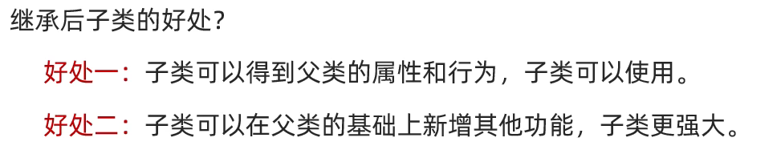

> **继承的特点：**
>
> 1.java只支持**单继承**，不支持**多继承**，但支持**多层继承。**
>
> 2.直接继承的父类叫直接父类，间接继承的爷爷叫间接父类
>
> 3.java中的顶级父类为：Object，每一个类都直接或间接的继承于Object

**单继承：**一个子类只能继承一个父类

**不能多继承：**子类不能同时继承多个父类

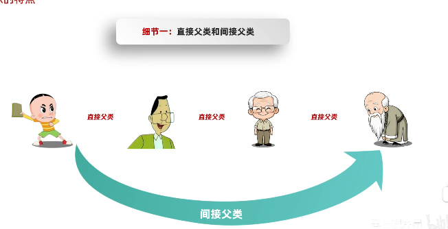


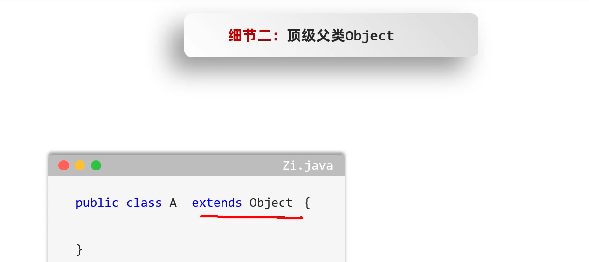

> 当这个类没有父类时，虚拟机会自动继承Object父类。

### 1.1继承中的成员变量


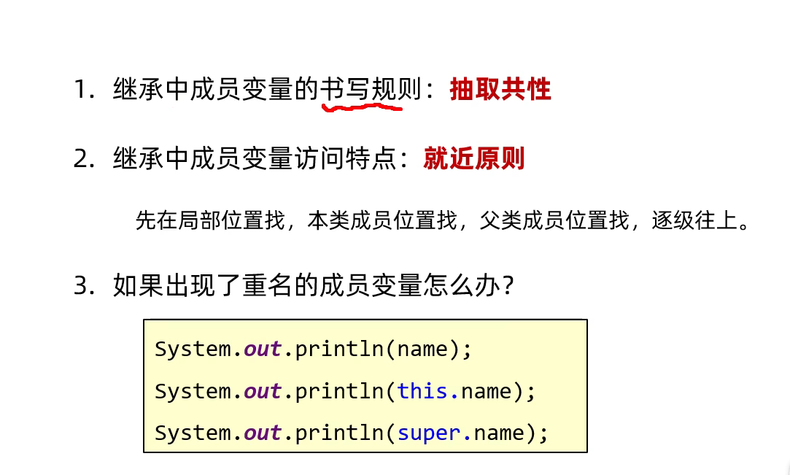

### 1.2成员方法

**书写规则：**把多个子类中共性的成员方法抽取到父类

**调用规则：**遵守就近原则

#### 1.2.1方法的重写

**方法重写：**在子类中，把父类的方法再写一遍，方法声明保持一致(有Override注解)

**使用场景：**如果父类的方法不能满足子类的要求了，子类中可以把该方法再重写一遍

> 1.重写方法的名称，形参列表必须与父类中的一致，方法体按照实际需求书写。
>
> 2.final修饰类为最终类，里面所有的方法不能被重写
>
> 3.private私有方法，static静态方法，final最终方法不能被重写

### 1.3构造方法

**父类中的构造方法不会被子类继承，只能通过super关键字调用**

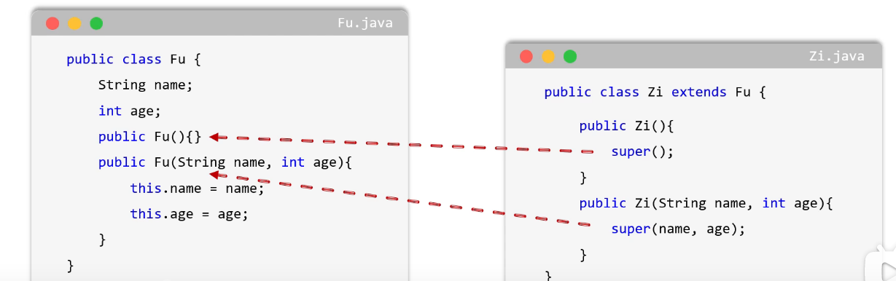

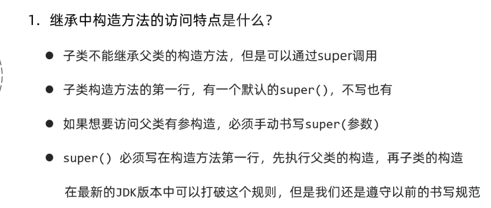

### 1.4 this和super关键字

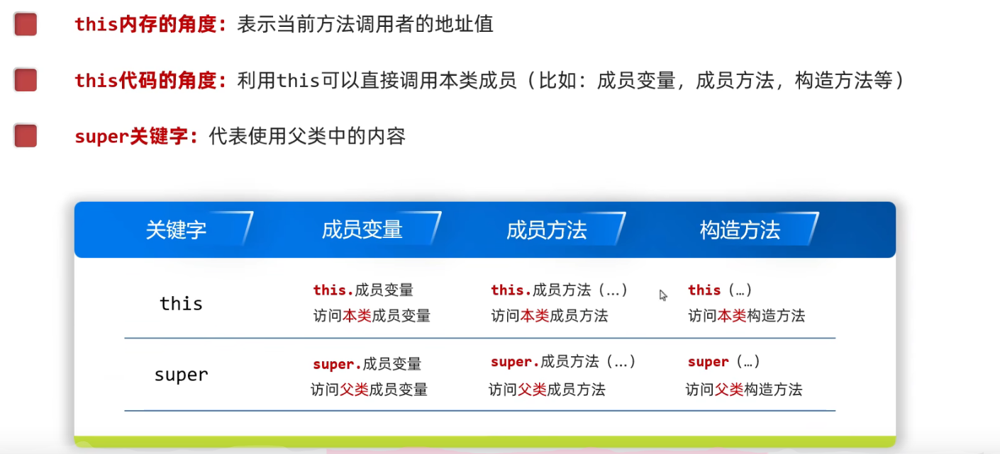

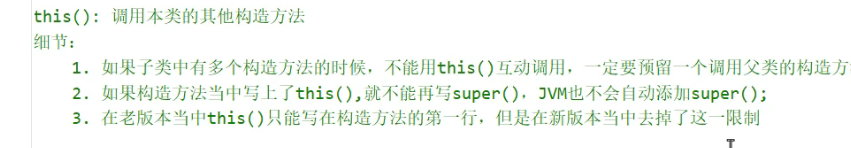

### 1. 5总结

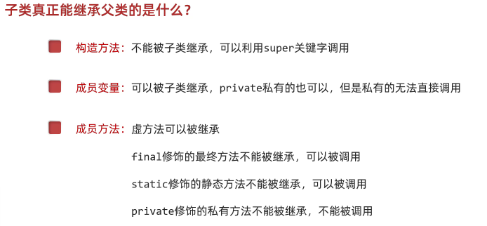

#### 1.5.1

**虚方法**

> 就是普通的成员方法，非final，非static，非private修饰的方法

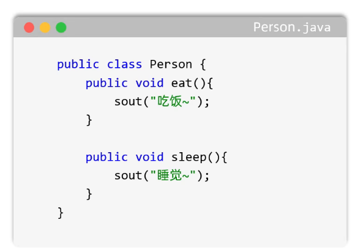

### 1.6 java中的权限修饰符

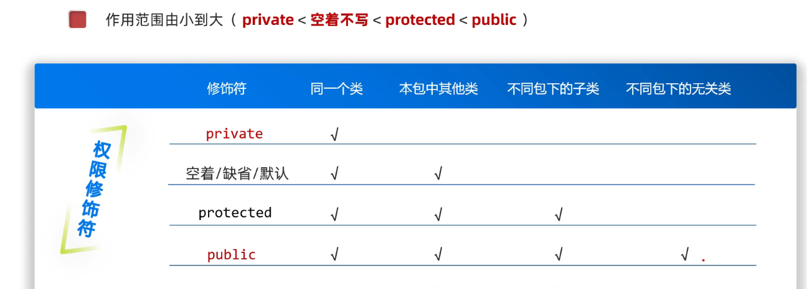

## 2.多态

**同一个父类引用，在指向不同子类对象时，调用同一个方法，会表现出不同的行为**

> 如下试例

```java
class Animal {
    public void eat() {
        System.out.println("动物吃东西");
    }
}

class Dog extends Animal {
    @Override
    public void eat() {
        System.out.println("狗吃骨头");
    }
}

class Cat extends Animal {
    @Override
    public void eat() {
        System.out.println("猫吃鱼");
    }
}
-------------------------------
Animal a1 = new Dog();
Animal a2 = new Cat();

a1.eat();//狗吃骨头
a2.eat();//猫吃鱼
```

> **Animal a1**叫做父类引用
>
> **new Dog()**叫做子类对象
>
> 只要存在继承关系就可以**Animal a1 = new Dog();**

### 2.1 多态的前提

- 有继承关系

- 子类必须重写父类的方法

- 有父类引用指向子类对象   

  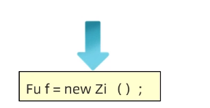

> 详细见
>
> D:\Code\Java\test5_29\out\production\test6_1 Chapter2.advancedoo.Polym.Test

### 2.2 多态特点

- 成员变量：**编译运行都看父**。
- 静态方法(static修饰)：**编译运行都看父**。
- 非静态方法（成员方法）：**编译看父，运行看子**（重写）

### 2.3 多态的优缺点

**优势：**方法中，使用父类型作为参数，可以接收所有子类对象。把不同的子类对象，统一当成父类来处理。

**缺点：**不能使用子类的特有功能

### 2.4 引用数据类型的类型转换的几种方式

```java
//自动类型转换

//强制类型转换
Person p = new Student();

Student s=(Student)p;

//instanceof转换

        if( a instanceof Dog d) //判断(true)转换为Dog类型,并赋值给变量 d
        {
         
        }else if( a instanceof Cat c) {
            
        }else
        {
            
        }
```

> 1.强制转换可以转换成真正的子类型，从而调用子类独有功能
>
> 2.转换类型与真实类型不一致会报错
>
> 3.强转时最好用instanceof关键字进行判断

## 3.抽象方法

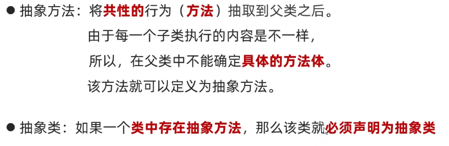

```java
//定义抽象方法
public abstract 返回值类型 方法名(参数列表);

//定义抽象类
public abstract class 类名{}
```

> **注意：**
>
> 1.抽象类不能直接创建对象
>
> 2.子类继承抽象类后，必须重写抽象方法

## 4.接口

> 一种规则或者规范，只规定“应该有什么功能”，不规定“具体怎么实现”。

### **4.1接口的定义和使用**

- 接口用关键字interface来定义

  ```java
  public interface 接口名{}
  ```

- 接口不能实例化

- 接口与类之间是实现关系，通过implements关键字表示

  ```java
  public class 类名 implements 接口名{}
  ```

- 接口的子类（实现类）

  要么重写接口中的所有抽象方法

  要么是抽象类

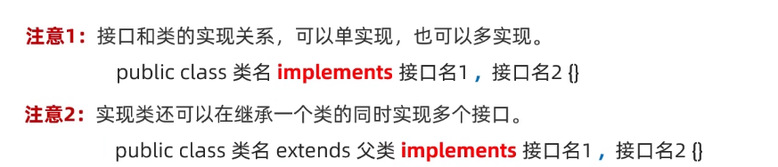

### 4.2 接口中的成员特点

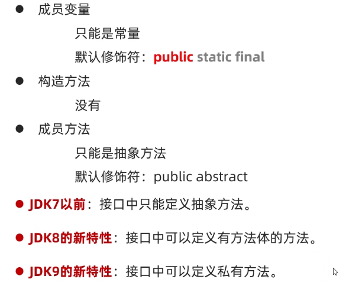

### 4.3 接口和类之间的关系

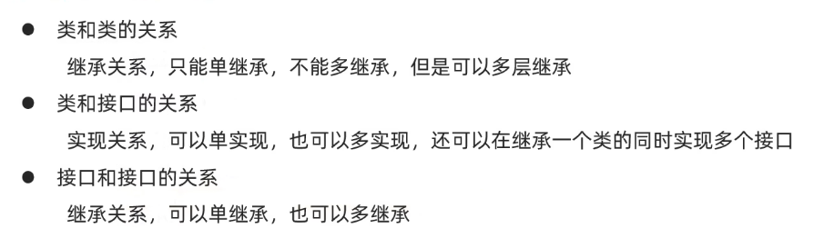

## 5.内部类

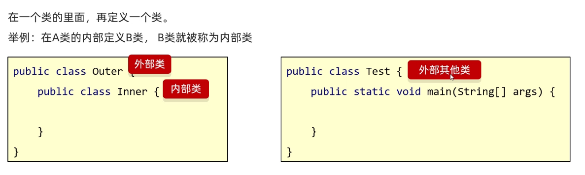

> *什么时候用到内部类?*
>
> B类表示的事物是A类的一部分，且B单独存在没有意义。比如：汽车的发动机，人的心脏

**内部类的特点：**

1. 内部类可以直接访问外部类的成员，包括 private 成员。

### 5.1内部类的应用

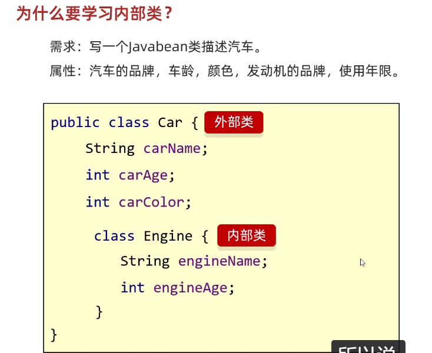

### 5.2内部类的分类

#### 1.成员内部类

```java
public class Outer{
    String name="外部类";
    
    private class Inner{
        public void show(){
            System.out.println("内部类");
        }
    }
    
    //通过方法后面可以调用被private修饰的内部类
    public Inner getInstance() {
        return new Inner();//new Inner() 是创建 Inner 对象的表达式；执行之后得到的是一个 Inner 对象的引用。
    }
}
/*
这里 Inner 和成员变量、成员方法一样，都是 Outer 的成员。
所以叫成员内部类
*/

```

**创建成员内部类的对象**

```java
//非private修饰的
Outer.Inner i=new Outer().new Inner();//通过外部类对象创建内部类对象
i.show();//调用内部类方法

//private修饰的
Outer o=new Outer(); 
System.out.println(o.getInstance());
```

#### 2.静态内部类

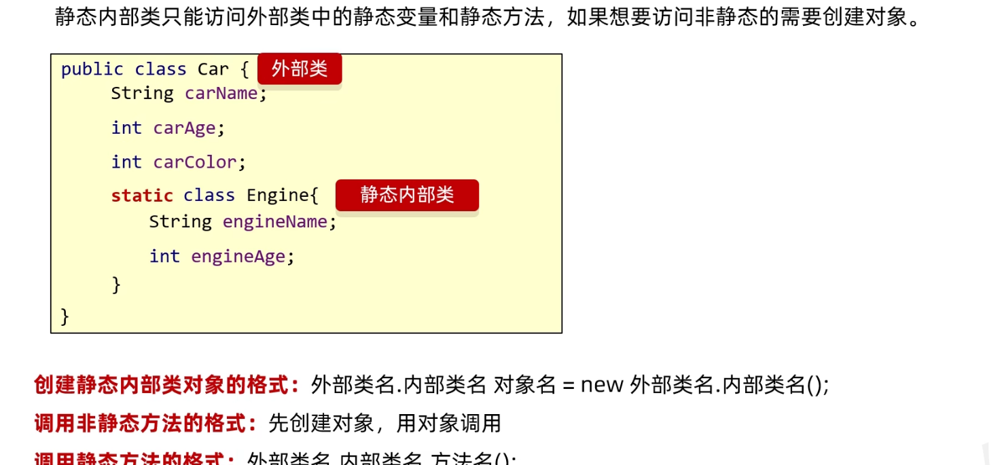

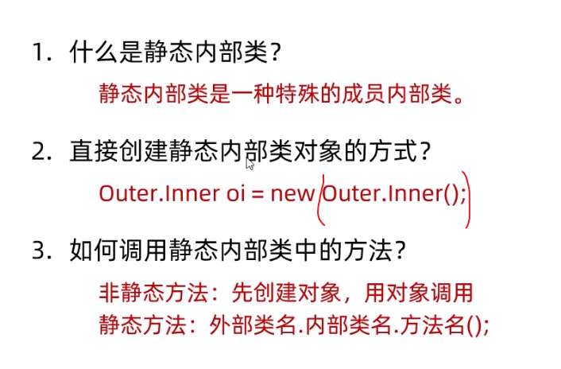

#### 2.局部内部类

**局部内部类，就是定义在方法里面的内部类。**

```java
public class Outer {

    public void show() {
		//这个 Inner 只在 show() 方法内部有效
        class Inner {
            public void method() {
                System.out.println("我是局部内部类");
            }
        }

        Inner i = new Inner();
        i.method();
    }
}
```

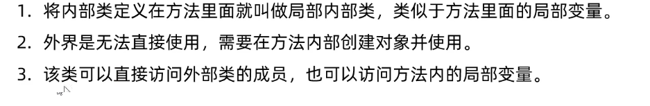

#### 匿名内部类

**匿名内部类** = **没有名字** + **一次性使用** + **局部内部类**。
本质是创建一个**接口的实现类对象**或**父类的子类对象**，但省略了类的定义过程。

```java
// 模板1：实现接口
new 接口名() {
    // 实现所有抽象方法
};

// 模板2：继承类
new 父类名() {
    // 重写父类方法
};

//实现接口（Runnable）
Runnable task = new Runnable() {
    @Override
    public void run() {
        System.out.println("任务执行中");
    }
};
task.run();


//继承父类（重写方法）
Animal dog = new Animal() {
    @Override
    public void shout() {
        System.out.println("汪汪");
    }
};
dog.shout();


//作为参数传递（最简写法）
button.addActionListener(new ActionListener() {
    @Override
    public void actionPerformed(ActionEvent e) {
        System.out.println("按钮被点击");
    }
});
```

> - 编译后，每个匿名内部类会生成独立的 `.class` 文件，命名格式为：
>   `外部类名$数字.class` （如 `Test$1.class`）

## 杂七杂八

### 1. 包

**包的作用：**用来管理不同功能的java类

**命名规范：**公司域名反写+包的作用，全英文小写，如com.itheima.domain

**使用其他类的规则：**

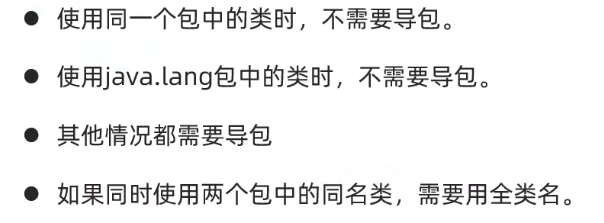

**全类名：**包名+类名

### 2. 常量

**命名规范：**

1. 单个单词：全部大写
2. 多个单词：全部大写，单词之间用下划线隔开

```java
//常量定义
private static final String ABC ="1";
```
