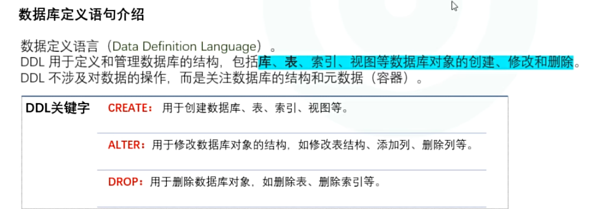
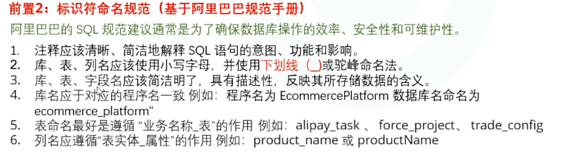

1. cmd命令窗口
2. 连接MySQL服务命令

```bash
mysql -uroot -proot

mysql -uroot -p
```

> u后接的是用户名
>
> p后接的是密码
>
> sql语句以;号结束
>
> sql注释 #
>
> select version() ,查看MySQL版本号


**创建库**– –>**定字段**– –>**创建表**– –>**插数据**

## 数据库定义语句



## SQL命名规定和规范



