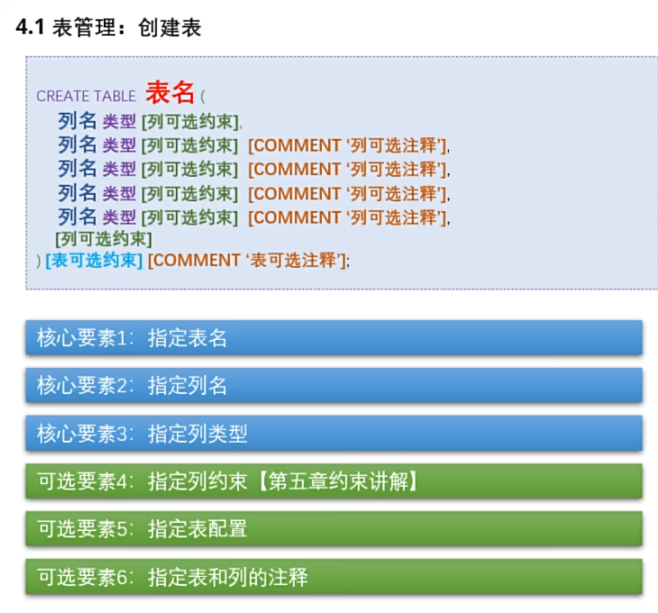
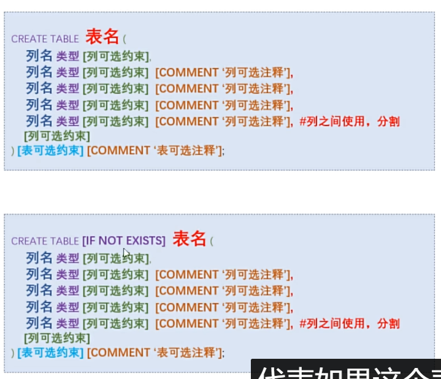
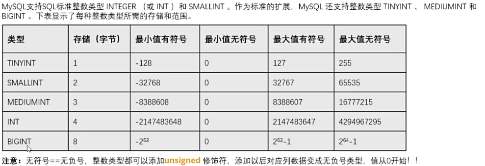
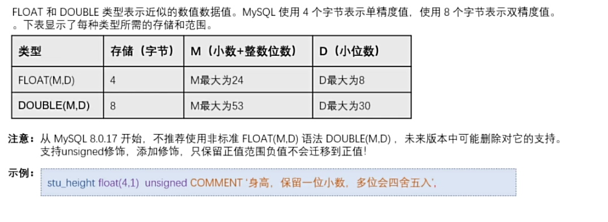
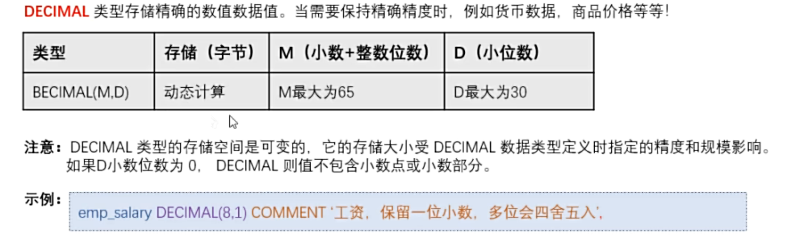
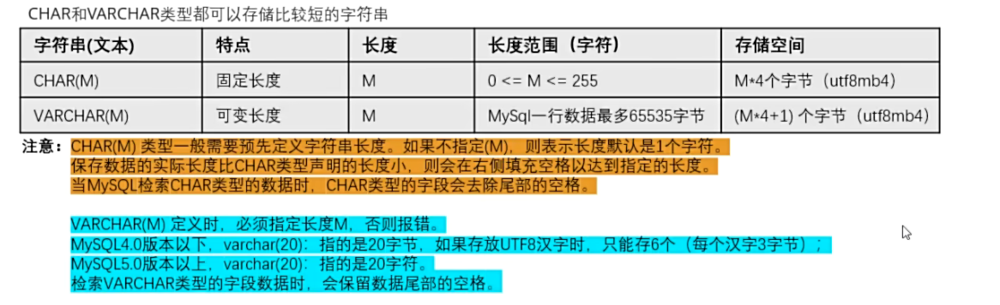
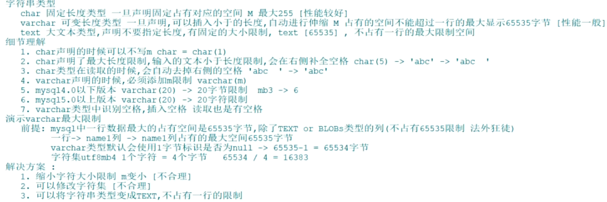
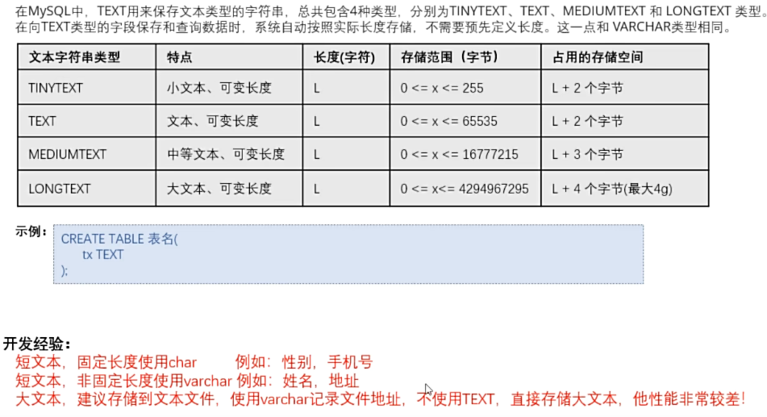
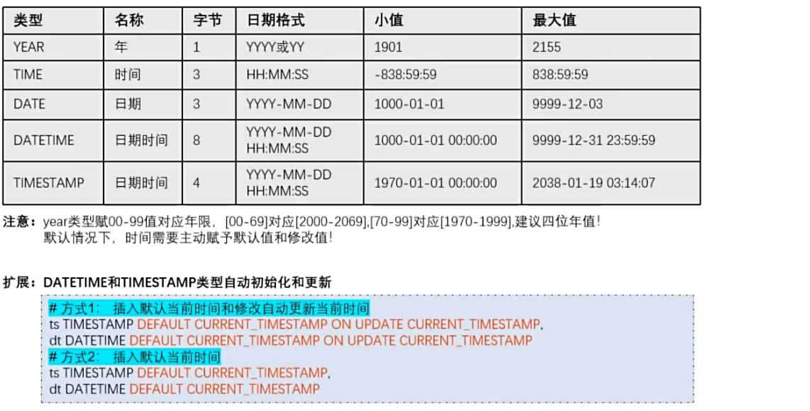

## 库操作

### 1.创建库

```sql
#创建数据库
create database 数据库名;

#判断再创建数据库
create database if not exists 数据库名;

#创建数据库指定字符集
create database 数据库名 character set 字符集 collate 排序方式;

#查询数据库的字符集和排序方式
mysql8 : 默认 utf8mb4 utf8mb4_0900_ai_ci
show variables like 'character_set_database';
show variables like 'collation_database';

```

### 2.查看库

```sql
# 查看当前所有库
 show databases;
 
#查看当前使用库
select database();

#查看指定库下所有表
show tables from 数据库名;

#查看创建库的信息
show create database 数据库名;

#切换库/选择库
use 数据库名;
```

### 3.修改/删除库

```sql
#修改库编码字符集
alter database 数据库名 character 字符集; #修改字符集
alter database 数据库名 collate 排序方式; #修改排序方式
alter database 数据库名 character set 字符集 collate 排序方式;#修改字符集和排序方式


#删除库(需要三思而后行)
#直接删除库
drop database 数据库名;

#判断并删除库(推荐)
drop database if exists 数据库名;
```

> **注意：**
>
> DATABASE 不能改名。一些可视化工具是通过新建库，再把表复制到新库，再删除旧库完成的

## 表操作



### 1.创建表



> 关键点：
>
> 1.表名，列表，类型必须填写，其他可选
>
> 2.推荐if not exists,直接创建存在报错风险
>
> 3.注释COMMENT不是必须的，但是很有必要
>
> 4.列之间使用“ ，”进行分割

```sql
#例
create table if not exists books(
	#列的信息
book_name varchar(20) COMMENT '图书名称',
book_price double(4,1) COMMENT '图书价格',
book_num int COMMENT '图书数量'
)charset =utf8mb4 COMMENT '图书表';

#查看数据库中的所有表
show tables from 数据库名;
```

### 2表管理(数据类型):

#### (1)整数



```sql
#例
age tinyint unsigned COMMENT '年龄 无负号值 从0开始'
#unsigned 必须紧靠类型后放置
```

#### (2)小数



> **M**：**精度**。代表**总共能存储的位数**（整数部分 + 小数部分）。
>
> **D**：**标度**。代表**小数部分的位数**。

#### (3)定点数(可替代float和double



> 使用对比:
>
> 精度要求高使用定点数，不高使用float和double

#### (4)字符串




一些补充



#### (5)数据类型 (文本类型



#### (6)时间类型



### 综合案例

```sql
create table if not exists student(
stu_name varchar(20) comment '学生姓名',
stu_sex char comment '学生性别',
stu_age tinyint unsigned comment '学生年龄',
stu_height TINYINT UNSIGNED COMMENT '学生身高',
stu_birthday date comment '学生生日',
stu_regtime timestamp default current_timestamp comment '注册时间',
stu_uptime  TIMESTAMP DEFAULT CURRENT_TIMESTAMP on update CURRENT_TIMESTAMP COMMENT '更新时间'
);
```

### 3.修改表

```sql
#修改表中列(字段)
#修改表，添加一列
alter table 表名 add 列名 字段类型 [first|after 原列名];

#修改表，修改列名
alter table 表名 change 原字段名 新列名 新字段类型 [first|after 原列名];

#修改表,修改列类型
alter table 表名 modify 列名 新字段类型 [first|after 原列名];

#修改表，删除一列
alter table 表名 drop 字段名;


#修改表名
alter table 表名 rename [to] 新表名;


####实例
-- 假设已有 users 表，结构为：id INT, name VARCHAR(50), age INT

-- 1. 添加一列（在最后添加 email，然后再在 name 后面添加 gender）
ALTER TABLE users ADD email VARCHAR(100);
ALTER TABLE users ADD gender CHAR(1) AFTER name;

-- 2. 修改列名（将 age 改为 user_age，同时将类型改为 TINYINT）
ALTER TABLE users CHANGE age user_age TINYINT;

-- 3. 修改列类型（将 name 的长度从 50 改为 100，且放在 id 之后）
ALTER TABLE users MODIFY name VARCHAR(100) AFTER id;

-- 4. 删除一列（删除 gender 列）
ALTER TABLE users DROP gender;

-- 5. 修改表名（将 users 改为 user_info）
ALTER TABLE users RENAME TO user_info;
```

### 4.删除表

```sql
#删除数据表
drop table [if exists]数据表1[,数据表2,···,数据表n];

#清空表数据(清空表中所有数据,保留格式)
truncate table 表名;
```

```sql
CREATE TABLE IF NOT EXISTS employees(
emp_num INT(11),
last_name VARCHAR(50),
first_name VARCHAR(50),
mobile VARCHAR(25),
`code` INT,
job_title VARCHAR(50),
birth DATE,
note VARCHAR(255),
sex VARCHAR(5)
);

#查看表的结构定义
DESC employees;

ALTER TABLE employees MODIFY mobile VARCHAR(25) AFTER `code`;

ALTER TABLE employees CHANGE birth birthday DATE;

ALTER TABLE employees MODIFY sex CHAR;

ALTER TABLE employees DROP note;

ALTER TABLE employees RENAME employees_info;

#显示当前数据库中所有表的SQL命令。
SHOW TABLES;
```
