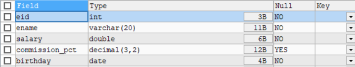

## 基本select数查询语句

```sql
#查询全部列的信息
select * from 表名;

#查询全部员工姓名(ename)和工资(salary)
select ename,salary from 表名

#查询列并且取别名
#将姓名(ename)显示为name
1 select ename as name,salary from 表名;
2  select ename name,salary from 表名;

#去掉重复行数据(只能单独使用)
select distinct gender(列名) from 表名;

#查询常数列 人为制造的一个值和一个列
#select 列名,列名,'值' (as) 列名 from 表名;
select ename,salary,'尚硅谷' company from 表名

#查询所有员工信息，并且添加一列etype,值固定为‘总部’
select * ,'总部' etype from t_employee; 
```

#### 显示表结构

```sql
DESC t_employee; 
```



#### 过滤数据

**where 添加以后，就不是全表查询，先过滤 符合再返回对应列**

```sql
select 列名1,列名2 from 表名 where 过滤条件;
```

## 运算符使用

### 1.算术运算符

| 运算符       | 说明         |                  示例                   |
| :----------- | :----------- | :-------------------------------------: |
| `DIV`        | 整除         |           `SELECT 10 DIV 3;`            |
| `+`          | 加法         |             `SELECT 3 + 5;`             |
| `-`          | 减法         |            `SELECT 10 - 4;`             |
| `*`          | 乘法         |             `SELECT 2 * 6;`             |
| `/`          | 除法         |            `SELECT 15 / 3;`             |
| `%` 或 `MOD` | 取模（余数） | `SELECT 10 % 3;` 或 `SELECT MOD(10,3);` |

### 2.比较运算符

| 运算符                    | 说明                      | 示例                              |
| :------------------------ | :------------------------ | :-------------------------------- |
| `=`                       | 等于                      | `WHERE age = 18`                  |
| `<>` 或 `!=`              | 不等于                    | `WHERE name != 'Tom'`             |
| `>`                       | 大于                      | `WHERE price > 100`               |
| `<`                       | 小于                      | `WHERE age < 60`                  |
| `>=`                      | 大于等于                  | `WHERE score >= 60`               |
| `<=`                      | 小于等于                  | `WHERE score <= 100`              |
| `<=>`                     | 安全的等于（可比较 NULL） | `WHERE a <=> NULL`                |
| `IS NULL`                 | 判断 NULL                 | `WHERE email IS NULL`             |
| `IS NOT NULL`             | 判断非 NULL               | `WHERE phone IS NOT NULL`         |
| `BETWEEN ... AND ...`     | 区间内                    | `WHERE age BETWEEN 18 AND 30`     |
| `NOT BETWEEN ... AND ...` | 区间外                    | `WHERE age NOT BETWEEN 18 AND 30` |
| `IN()`                    | 在集合中                  | `WHERE dept IN ('HR','IT')`       |
| `NOT IN()`                | 不在集合中                | `WHERE dept NOT IN ('HR','IT')`   |
| `LIKE`                    | 模糊匹配                  | `WHERE name LIKE '张%'`           |
| `NOT LIKE`                | 不匹配模糊                | `WHERE name NOT LIKE '李%'`       |
| `REGEXP` 或 `RLIKE`       | 正则表达式匹配            | `WHERE name REGEXP '^[A-Z]'`      |

> 注意：比较运算符结果为1,0，null
>
> 1表示true ，0和null表示false
>
> ‘1’=1为true

 **LIKE 通配符**

| 通配符 | 说明   | 匹配内容                            |
| :----- | :----- | :---------------------------------- |
| `%`    | 百分号 | 匹配**任意数量**的字符（包括 0 个） |
| `_`    | 下划线 | 匹配**恰好一个**字符                |

```sql
select 'sss' like '%','sss' like '___','ss'like '_';#结果为1,1,0
```

### 逻辑运算符

| 运算符        | 说明                   | 示例                |
| :------------ | :--------------------- | :------------------ |
| `AND` 或 `&&` | 逻辑与（都为真才真）   | `WHERE a=1 AND b=2` |
| `OR` 或 `\|\|`  | 逻辑或（至少一个真）   | `WHERE a=1 OR b=2`  |
| `NOT` 或 `!`  | 逻辑非（取反）         | `WHERE NOT a=1`     |
| `XOR`         | 逻辑异或（恰一个为真） | `WHERE a=1 XOR b=2` |

>  `FIND_IN_SET` 函数解释
>
> **语法**：`FIND_IN_SET(str, strlist)`
>
> - **str**：要查找的字符串
> - **strlist**：逗号分隔的字符串列表
>
> **返回值**：
>
> - 如果找到，返回 `str` 在 `strlist` 中的**位置**（从1开始计数）
> - 如果没找到，返回 `0`

 **运算符优先级（从高到低）**

1. `!`
2. `-`（负号）、`~`（位取反）
3. `^`（位异或）
4. `*`、`/`、`%`
5. `+`、`-`
6. `<<`、`>>`
7. `&`
8. `|`
9. `=`、`<>`、`<=>`、`<`、`<=`、`>`、`>=`、`LIKE`、`IN`、`BETWEEN`、`REGEXP`
10. `NOT`
11. `AND`、`&&`
12. `XOR`
13. `OR`、`||`
14. `=`（赋值）

> **提示**：建议使用括号 `( )` 明确运算顺序，提高可读性并避免优先级错误。

## 单行和多行函数

### 单行函数

#### 数值函数

##### 1. 基本运算函数

| 函数        | 说明                                  | 示例         | 结果 |
| :---------- | :------------------------------------ | :----------- | :--- |
| `ABS(x)`    | 绝对值                                | `ABS(-5.6)`  | 5.6  |
| `SIGN(x)`   | 符号（正数返回1，负数返回-1，0返回0） | `SIGN(-8)`   | -1   |
| `MOD(x, y)` | 取余（同 `x % y`）                    | `MOD(10, 3)` | 1    |

##### 2. 舍入与截断函数

| 函数                     | 说明                              | 示例                 | 结果 |
| :----------------------- | :-------------------------------- | :------------------- | :--- |
| `ROUND(x)`               | 四舍五入到整数                    | `ROUND(4.56)`        | 5    |
| `ROUND(x, d)`            | 四舍五入保留d位小数               | `ROUND(4.567, 2)`    | 4.57 |
| `TRUNCATE(x, d)`         | 直接截断保留d位小数（不四舍五入） | `TRUNCATE(4.567, 2)` | 4.56 |
| `FLOOR(x)`               | 向下取整（返回≤x的最大整数）      | `FLOOR(4.9)`         | 4    |
| `CEIL(x)` / `CEILING(x)` | 向上取整（返回≥x的最小整数）      | `CEIL(4.1)`          | 5    |

##### 3. 随机数函数

| 函数       | 说明                          | 示例        | 结果             |
| :--------- | :---------------------------- | :---------- | :--------------- |
| `RAND()`   | 返回0~1之间的随机小数         | `RAND()`    | 0.23456789...    |
| `RAND(n)`  | 使用种子n生成固定序列的随机数 | `RAND(100)` | 每次运行结果相同 |
| `RANDOM()` | MySQL 8.0.3+ 同 `RAND()`      | -           | -                |

##### 4. 三角函数（弧度制）

| 函数          | 说明         | 示例          | 结果          |
| :------------ | :----------- | :------------ | :------------ |
| `SIN(x)`      | 正弦         | `SIN(PI()/2)` | 1             |
| `COS(x)`      | 余弦         | `COS(0)`      | 1             |
| `TAN(x)`      | 正切         | `TAN(PI()/4)` | 1             |
| `ASIN(x)`     | 反正弦       | `ASIN(1)`     | 1.5708（π/2） |
| `ACOS(x)`     | 反余弦       | `ACOS(1)`     | 0             |
| `ATAN(x)`     | 反正切       | `ATAN(1)`     | 0.7854（π/4） |
| `ATAN2(y, x)` | 两参数反正切 | `ATAN2(1, 1)` | 0.7854        |

##### 5. 弧度与度数转换

| 函数         | 说明       | 示例            | 结果         |
| :----------- | :--------- | :-------------- | :----------- |
| `RADIANS(x)` | 度数转弧度 | `RADIANS(180)`  | 3.14159（π） |
| `DEGREES(x)` | 弧度转度数 | `DEGREES(PI())` | 180          |

##### 6. 指数与对数函数

| 函数                        | 说明                  | 示例           | 结果       |
| :-------------------------- | :-------------------- | :------------- | :--------- |
| `POW(x, y)` / `POWER(x, y)` | x的y次方              | `POW(2, 3)`    | 8          |
| `SQRT(x)`                   | 平方根                | `SQRT(16)`     | 4          |
| `EXP(x)`                    | e的x次方              | `EXP(1)`       | 2.71828... |
| `LOG(x)`                    | 自然对数（以e为底）   | `LOG(2.71828)` | ~1         |
| `LOG10(x)`                  | 以10为底的对数        | `LOG10(100)`   | 2          |
| `LOG2(x)`                   | 以2为底的对数         | `LOG2(8)`      | 3          |
| `LN(x)`                     | 同 `LOG(x)`，自然对数 | `LN(2.71828)`  | ~1         |

##### 7. 其他实用函数

| 函数                          | 说明             | 示例                   | 结果              |
| :---------------------------- | :--------------- | :--------------------- | :---------------- |
| `PI()`                        | 圆周率π          | `PI()`                 | 3.141592653589793 |
| `GREATEST(a, b, c...)`        | 返回最大值       | `GREATEST(3, 5, 1, 8)` | 8                 |
| `LEAST(a, b, c...)`           | 返回最小值       | `LEAST(3, 5, 1, 8)`    | 1                 |
| `POWER(x, y)`                 | 同 `POW(x, y)`   | `POWER(3, 2)`          | 9                 |
| `CONV(n, from_base, to_base)` | 进制转换         | `CONV('A', 16, 10)`    | 10                |
| `BIN(x)`                      | 转二进制字符串   | `BIN(5)`               | '101'             |
| `OCT(x)`                      | 转八进制字符串   | `OCT(8)`               | '10'              |
| `HEX(x)`                      | 转十六进制字符串 | `HEX(255)`             | 'FF'              |

##### 字符串函数

##### 1. 大小写转换函数

| 函数                        | 说明     | 示例             | 结果    |
| :-------------------------- | :------- | :--------------- | :------ |
| `UPPER(str)` / `UCASE(str)` | 转为大写 | `UPPER('hello')` | 'HELLO' |
| `LOWER(str)` / `LCASE(str)` | 转为小写 | `LOWER('WORLD')` | 'world' |

##### 2. 字符串长度函数

| 函数                    | 说明                           | 示例                  | 结果           |
| :---------------------- | :----------------------------- | :-------------------- | :------------- |
| `LENGTH(str)`           | 返回**字节数**（受字符集影响） | `LENGTH('你好')`      | 6（utf8mb4下） |
| `CHAR_LENGTH(str)`      | 返回**字符数**                 | `CHAR_LENGTH('你好')` | 2              |
| `CHARACTER_LENGTH(str)` | 同 `CHAR_LENGTH()`             | -                     | -              |
| `BIT_LENGTH(str)`       | 返回**位数**                   | `BIT_LENGTH('A')`     | 8              |

##### 3. 拼接与分割函数

| 函数                              | 说明                 | 示例                                 | 结果             |
| :-------------------------------- | :------------------- | :----------------------------------- | :--------------- |
| `CONCAT(str1, str2, ...)`         | 拼接多个字符串       | `CONCAT('A', 'B', 'C')`              | 'ABC'            |
| `CONCAT_WS(sep, str1, str2, ...)` | 用分隔符拼接         | `CONCAT_WS('-', '2024', '01', '15')` | '2024-01-15'     |
| `GROUP_CONCAT()`                  | 聚合拼接（聚合函数） | `GROUP_CONCAT(name SEPARATOR ',')`   | '张三,李四,王五' |

##### 4. 截取与提取函数

| 函数                                 | 说明                   | 示例                               | 结果   |
| :----------------------------------- | :--------------------- | :--------------------------------- | :----- |
| `SUBSTRING(str, pos)`                | 从pos开始截取到末尾    | `SUBSTRING('hello', 2)`            | 'ello' |
| `SUBSTRING(str, pos, len)`           | 从pos开始截取len个字符 | `SUBSTRING('hello', 2, 3)`         | 'ell'  |
| `SUBSTR(str, pos, len)`              | 同 `SUBSTRING()`       | -                                  | -      |
| `LEFT(str, len)`                     | 从左截取len个字符      | `LEFT('hello', 3)`                 | 'hel'  |
| `RIGHT(str, len)`                    | 从右截取len个字符      | `RIGHT('hello', 2)`                | 'lo'   |
| `SUBSTRING_INDEX(str, delim, count)` | 根据分隔符截取         | `SUBSTRING_INDEX('a@b@c', '@', 2)` | 'a@b'  |

##### 5. 查找与定位函数

| 函数                          | 说明                         | 示例                        | 结果 |
| :---------------------------- | :--------------------------- | :-------------------------- | :--- |
| `LOCATE(substr, str)`         | 返回子串第一次出现的位置     | `LOCATE('ll', 'hello')`     | 3    |
| `LOCATE(substr, str, pos)`    | 从指定位置开始查找           | `LOCATE('l', 'hello', 4)`   | 4    |
| `POSITION(substr IN str)`     | 同 `LOCATE()`                | `POSITION('ll' IN 'hello')` | 3    |
| `INSTR(str, substr)`          | 返回子串位置（参数顺序相反） | `INSTR('hello', 'l')`       | 3    |
| `FIELD(str, str1, str2, ...)` | 返回字符串在列表中的位置     | `FIELD('b', 'a', 'b', 'c')` | 2    |
| `FIND_IN_SET(str, strlist)`   | 在逗号分隔的列表中查找       | `FIND_IN_SET('b', 'a,b,c')` | 2    |

##### 6. 去除空格函数

| 函数                          | 说明             | 示例                              | 结果  |
| :---------------------------- | :--------------- | :-------------------------------- | :---- |
| `TRIM(str)`                   | 去除首尾空格     | `TRIM(' hi ')`                    | 'hi'  |
| `LTRIM(str)`                  | 去除左侧空格     | `LTRIM(' hi')`                    | 'hi'  |
| `RTRIM(str)`                  | 去除右侧空格     | `RTRIM('hi ')`                    | 'hi'  |
| `TRIM(BOTH 'x' FROM str)`     | 去除指定字符     | `TRIM(BOTH 'x' FROM 'xxhixx')`    | 'hi'  |
| `TRIM(LEADING 'x' FROM str)`  | 去除左侧指定字符 | `TRIM(LEADING '0' FROM '00123')`  | '123' |
| `TRIM(TRAILING 'x' FROM str)` | 去除右侧指定字符 | `TRIM(TRAILING '0' FROM '12300')` | '123' |

##### 7. 替换与填充函数

| 函数                             | 说明               | 示例                          | 结果    |
| :------------------------------- | :----------------- | :---------------------------- | :------ |
| `REPLACE(str, from_str, to_str)` | 替换所有匹配的子串 | `REPLACE('hello', 'l', 'x')`  | 'hexxo' |
| `INSERT(str, pos, len, newstr)`  | 在指定位置替换子串 | `INSERT('hello', 2, 3, 'aa')` | 'hao'   |
| `LPAD(str, len, padstr)`         | 左填充到指定长度   | `LPAD('123', 5, '0')`         | '00123' |
| `RPAD(str, len, padstr)`         | 右填充到指定长度   | `RPAD('123', 5, '*')`         | '123**' |

##### 8. 翻转与重复函数

| 函数                 | 说明              | 示例               | 结果        |
| :------------------- | :---------------- | :----------------- | :---------- |
| `REVERSE(str)`       | 翻转字符串        | `REVERSE('hello')` | 'olleh'     |
| `REPEAT(str, count)` | 重复字符串count次 | `REPEAT('abc', 3)` | 'abcabcabc' |

##### 9. ASCII与字符转换

| 函数           | 说明                      | 示例               | 结果  |
| :------------- | :------------------------ | :----------------- | :---- |
| `ASCII(str)`   | 返回第一个字符的ASCII码   | `ASCII('A')`       | 65    |
| `CHAR(n, ...)` | 将ASCII码转字符           | `CHAR(65, 66, 67)` | 'ABC' |
| `ORD(str)`     | 返回第一个字符的Unicode值 | `ORD('你')`        | 20320 |

##### 10. 其他实用函数

| 函数                          | 说明                             | 示例                    | 结果        |
| :---------------------------- | :------------------------------- | :---------------------- | :---------- |
| `STRCMP(str1, str2)`          | 比较字符串（返回0、-1、1）       | `STRCMP('a', 'b')`      | -1          |
| `FORMAT(x, d)`                | 格式化数字（保留小数，加千分位） | `FORMAT(12345.678, 2)`  | '12,345.68' |
| `SPACE(n)`                    | 返回n个空格的字符串              | `SPACE(3)`              | ' '         |
| `REVERSE(str)`                | 翻转字符串                       | `REVERSE('hello')`      | 'olleh'     |
| `ELT(index, str1, str2, ...)` | 返回第index个字符串              | `ELT(2, 'a', 'b', 'c')` | 'b'         |

#### 时间函数

##### 1. 获取当前时间

| 函数        | 说明           | 示例结果              |
| :---------- | :------------- | :-------------------- |
| `NOW()`     | 当前日期和时间 | `2026-05-27 14:30:25` |
| `CURDATE()` | 当前日期       | `2026-05-27`          |
| `CURTIME()` | 当前时间       | `14:30:25`            |

##### 2. 提取部分信息

| 函数           | 说明     | 示例                  | 结果 |
| :------------- | :------- | :-------------------- | :--- |
| `YEAR(日期)`   | 提取年份 | `YEAR('2026-05-27')`  | 2026 |
| `MONTH(日期)`  | 提取月份 | `MONTH('2026-05-27')` | 5    |
| `DAY(日期)`    | 提取几号 | `DAY('2026-05-27')`   | 27   |
| `WEEK(日期)`   | 提取几周 | `week('2026-05-27')`  | 21   |
| `HOUR(时间)`   | 提取小时 | `HOUR('14:30:25')`    | 14   |
| `MINUTE(时间)` | 提取分钟 | `MINUTE('14:30:25')`  | 30   |
| `SECOND(时间)` | 提取秒数 | `SECOND('14:30:25')`  | 25   |

##### 3. 日期计算

| 函数                                         | 说明         | 示例                                       | 结果       |
| :------------------------------------------- | :----------- | :----------------------------------------- | :--------- |
| `DATE_ADD/adddate(日期, INTERVAL 数量 单位)` | 日期加法     | `DATE_ADD('2026-05-27', INTERVAL 7 DAY)`   | 2026-06-03 |
| `DATE_SUB/subdate(日期, INTERVAL 数量 单位)` | 日期减法     | `DATE_SUB('2026-05-27', INTERVAL 1 MONTH)` | 2026-04-27 |
| `DATEDIFF(日期1, 日期2)`                     | 计算相差天数 | `DATEDIFF('2026-06-01', '2026-05-27')`     | 5          |

> **常用时间单位：** `DAY`（天）、`MONTH`（月）、`YEAR`（年）、`HOUR`（小时）、`MINUTE`（分钟）

##### 4. 格式化显示

| 函数                      | 说明           | 示例                                 | 结果           |
| :------------------------ | :------------- | :----------------------------------- | :------------- |
| `DATE_FORMAT(日期, 格式)` | 按格式显示日期 | `DATE_FORMAT(NOW(), '%Y年%m月%d日')` | 2026年05月27日 |

> **常用格式代码：**
>
> - `%Y` - 4位年份（2026）
> - `%y` - 2位年份（26）
> - `%m` - 月份（01-12）
> - `%d` - 日期（01-31）
> - `%H` - 24小时制（00-23）
> - `%i` - 分钟（00-59）
> - `%s` - 秒（00-59）

#### 流程函数

```sql
#1
IF(condition, true_value, false_value)
#当condition成立时，返回前者，否则返回后者
#例
SELECT IF(score >= 60, '及格', '不及格') AS result FROM students;

#2
IFNULL(column,null_value)
#当指定列column值为null，取null_value的值为结果
SELECT IFNULL(column_name, '默认值') FROM table;  -- 判空

#3
#第一种
CASE expression
    WHEN value1 THEN result1
    WHEN value2 THEN result2
    ELSE default_result
END

#第二种
CASE
    WHEN condition1 THEN result1
    WHEN condition2 THEN result2
    ELSE default_result
END
#例
-- 成绩等级划分
SELECT 
    name,
    score,
    CASE
        WHEN score >= 90 THEN '优秀'
        WHEN score >= 80 THEN '良好'
        WHEN score >= 60 THEN '及格'
        ELSE '不及格'
    END AS level
FROM students;

-- 简单CASE
SELECT 
    order_id,
    CASE status
        WHEN 1 THEN '待付款'
        WHEN 2 THEN '已付款'
        WHEN 3 THEN '已发货'
        ELSE '未知状态'
    END AS status_name
FROM orders;
```

### 多行函数（聚合函数）

将多行数据作为一组进行计算，返回一个结果。

##### 1. 统计类

| 函数      | 说明                | 示例                            |
| :-------- | :------------------ | :------------------------------ |
| `COUNT()` | 统计行（忽略 NULL） | `SELECT COUNT(*) FROM user;`    |
| `SUM(列)` | 求和（忽略 NULL）   | `SELECT SUM(score) FROM exam;`  |
| `AVG(列)` | 平均值（忽略 NULL） | `SELECT AVG(age) FROM student;` |

##### 2. 极值类

| 函数      | 说明   | 示例                           |
| :-------- | :----- | :----------------------------- |
| `MAX(列)` | 最大值 | `SELECT MAX(salary) FROM emp;` |
| `MIN(列)` | 最小值 | `SELECT MIN(salary) FROM emp;` |

##### 3.分组查询

```sql
select分组列,聚合函数 from 表名
[where 语句]
[group by 分组列... having 分组后条件];
```

##### 4.排序查询

```sql
select 列,列,函数 from table_name [where ..] 
[order by 排序列 asc|desc, 排序列 asc|desc...];

#实例
#按照库存量降序排序，如果相同则安装note升序排序
SELECT * FROM books  ORDER BY num DESC,note;

```

> asc为正序默认值，desc为倒序
>
> 多列排序，只有第一列相同，第二列才会生效以此类推..

##### 5.数据切割

```sql
select 列，列，函数 from table_name
[where ..]
limit [位置偏移量],行数;
#位置偏移量默认是0，代表不偏移
#行数 指示返回的记录条数
```

> limit一定在select的最后page：第几页，size：页面显示多少
>
> limit(page-1)*size*,size;

3. **其他常用**

| 函数                 | 说明                   | 示例                                   |
| :------------------- | :--------------------- | :------------------------------------- |
| `GROUP_CONCAT()`     | 将分组的值连接成字符串 | `SELECT GROUP_CONCAT(name) FROM user;` |
| `STD()` / `STDDEV()` | 标准差                 | `SELECT STD(score) FROM exam;`         |
| `VARIANCE()`         | 方差                   | `SELECT VARIANCE(score) FROM exam;`    |
| `BIT_AND()`          | 按位与                 | `SELECT BIT_AND(flag) FROM config;`    |
| `BIT_OR()`           | 按位或                 | `SELECT BIT_OR(flag) FROM config;`     |
| `BIT_XOR()`          | 按位异或               | `SELECT BIT_XOR(flag) FROM config;`    |

##### 使用要点

1. 自动忽略 NULL

```sql
-- NULL 会被忽略，不会计入统计
SELECT AVG(commission) FROM emp;  -- 只计算有佣金的人
```

2 与 GROUP BY 配合

```sql
SELECT department, AVG(salary)
FROM emp
GROUP BY department;
```

3. HAVING 过滤分组

```sql
SELECT department, AVG(salary) as avg_sal
FROM emp
GROUP BY department
HAVING avg_sal > 5000;
```

4. DISTINCT 去重统计

```sql
SELECT COUNT(DISTINCT city) FROM user;
```

> 关键字顺序是不能颠倒的：
>
> select… from …where …group by… having …order by… limit…
>
> select语句的执行顺序:
>
> from->where->group by->having->select 的字段-> order by ->limit
>
> **标准SQl不允许where子句中引用列别名，这个限制是由于在评估where子句时，列的值可能尚未确定**


> **别名可以在查询选择列表中为列指定不同的名称，可以在group by，order by或having 子句中使用别名来引用 列**
