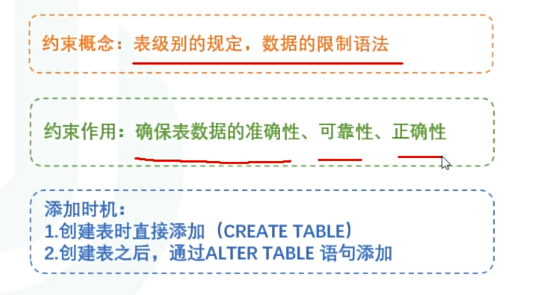
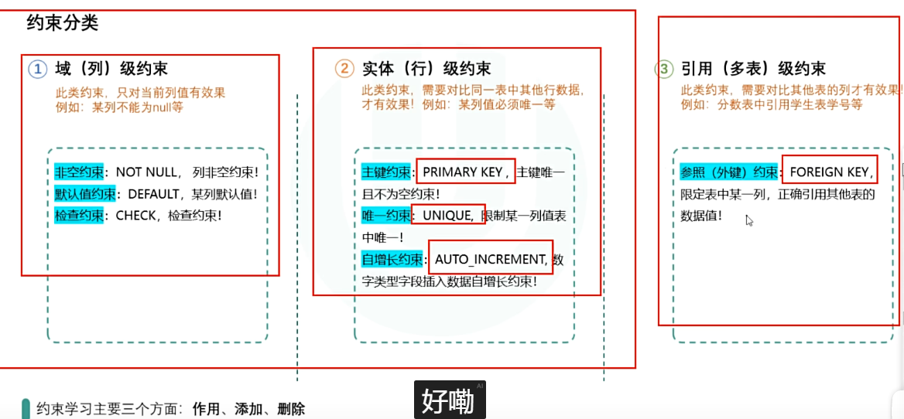
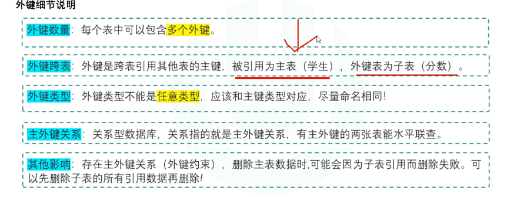

## 1.约束分类





## 2.域(列)级约束

### 2.1非空约束

```sql
#建表时添加
create table 表名{
	字段名 数据类型 not null,
	字段名 数据类型 not null
};

#建表后添加
alter table 表名 modify 字段名 数据类型 not null;

#实例

create table emp1{
 id int(10) not null,
 name varchar(29) not null,
 sex char(1)
};

alter table emp1 modify sex char(1) not null;

#删除 
alter table 表名 modify 字段名 数据类型 null;
或 alter table 表名 modify 字段名 数据类型
-不加默认允许null

alter table emp1 modify sex varchar(30) null;
```

### 2.2默认约束

```sql
#语法格式
 字段名 数据类型 default value;
 
 create table 表名{
	字段名 数据类型 not null default 默认值;

};
```

### 2.3检查约束

### 2.4主键约束

**主键保证 唯一且不为null**

```sql
#主键约束关键字 primary key
-- 定义字段时设置
create table goods{
	id int(11) primary key,
	...
};

-- 定义所有字段后设置
create table goods{
 	id int(11),
 	...
 	primary key(id)
};

-- 复合主键
CREATE TABLE score (
    student_id INT,
    course_id INT,
    score INT,
    PRIMARY KEY (student_id, course_id)  -- 这是一个主键，但有两列
);


```

> - **每张表最多只能有一个主键**（这是 SQL 标准，MySQL 也是）
> - 但这个主键可以包含**多个列**（称为复合主键/联合主键）

## 3.实体(行)级约束

### 3.1唯一约束

```sql
#字段值不允许重复，可为null,但是必须唯一
 create table 表名{
	字段名 数据类型 unique;
```

### 3.2自增长约束

```sql
#关键字 auto_increment

-- 确保主键列和唯一列的数字自动增长
create table goods{
	id int(11) primary key auto_increment,
	...
};
```

## 4.外键约束（基本不用）

**外键：**引用其他表主键列值的列，外键的值范围对应引用主键的值的范围




```sql
-- 先创建主表再创建子表

create table 主表名{
 	字段1 数据类型 primary key
 };
 
-- 子表中添加主外键约束
create table 子表名{
	constraint 外键名 foreign key  从表字段 reference 主键字段名 [on update xx] [on delete xx]
};


-- 实例
#主表
CREATE TABLE student(
sid INT PRIMARY KEY AUTO_INCREMENT,
ename VARCHAR(20)
);

#从表
CREATE TABLE score(
cid INT PRIMARY KEY AUTO_INCREMENT,
NUMBER INT,
sid INT,
CONSTRAINT s_s1 FOREIGN KEY (sid) REFERENCES student (sid)
)


```
