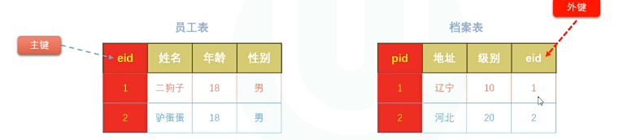

## 1.拆表存储数据的理由


## 2.多表关系

### 1对1



```sql
# 一对一: 员工和档案表
CREATE TABLE emp(
    e_id  INT PRIMARY KEY AUTO_INCREMENT,
    e_name  VARCHAR(20) NOT NULL,  
    e_age  INT DEFAULT 18,
    e_gender  CHAR DEFAULT '男'
);


#方案2: 正常存在外键,外键添加unique唯一约束
CREATE TABLE profile1(
    p_id  INT PRIMARY KEY AUTO_INCREMENT,
    p_address VARCHAR(100) NOT NULL,  
    p_level  INT  DEFAULT 10,
    e_id INT UNIQUE ,  # 外键唯一
    CONSTRAINT s_p_1  FOREIGN KEY(e_id) REFERENCES emp(e_id) 
);


#方案1: 外键直接当主键
CREATE TABLE profile2(
    e_id  INT PRIMARY KEY,
    p_address VARCHAR(100) NOT NULL,  
    p_level  INT  DEFAULT 10,
    CONSTRAINT s_p_2  FOREIGN KEY(e_id) REFERENCES emp(e_id) 
);

```


### 1对多

作者和文章的关系

```sql
CREATE TABLE author(
    a_id  INT PRIMARY KEY AUTO_INCREMENT,
    a_name  VARCHAR(20) NOT NULL,  
    a_age  INT DEFAULT 18,
    a_gender  CHAR DEFAULT '男'
);

CREATE TABLE blog(
    b_id  INT PRIMARY KEY AUTO_INCREMENT,
    b_title VARCHAR(100) NOT NULL,  
    b_content VARCHAR(600) NOT NULL,  
    a_id INT ,  # 外键 不加uinque约束
    CONSTRAINT a_b_fk  FOREIGN KEY(a_id) REFERENCES author(a_id) 
);


```


### 多对多

课表和学生的关系


```sql
CREATE TABLE student(
    s_id  INT PRIMARY KEY AUTO_INCREMENT,
    s_name  VARCHAR(20) NOT NULL,  
    s_age  INT DEFAULT 18
);

CREATE TABLE course(
    c_id  INT PRIMARY KEY AUTO_INCREMENT,
    c_name VARCHAR(10) NOT NULL,  
    c_teacher  VARCHAR(10) 
);

#中间表
CREATE TABLE student_course(
    sc_id  INT PRIMARY KEY AUTO_INCREMENT,
    s_id INT,  
    c_id  INT,
    FOREIGN KEY(s_id) REFERENCES student(s_id) ,
    FOREIGN KEY(c_id) REFERENCES course(c_id) 
);
```
