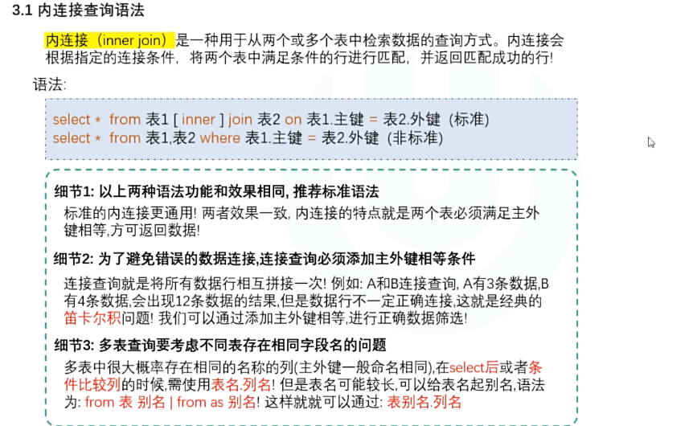
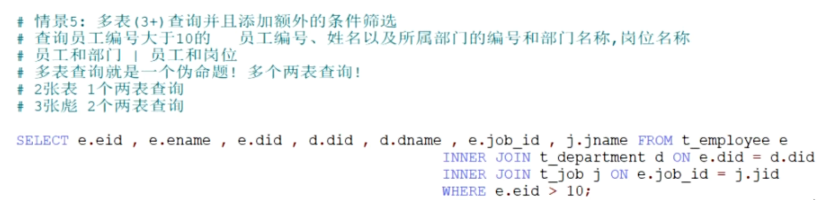

**合并语法：水平合并和垂直合并**

## 垂直合并语法

**语法**

union  合并记录同时去掉重复数据

union all 合并记录，且不去掉重复数据

```sql
-- 一班学生表
CREATE TABLE class1 (
    id INT,
    name VARCHAR(20)
);
INSERT INTO class1 VALUES (1, '张三'), (2, '李四'), (3, '王五');

-- 二班学生表
CREATE TABLE class2 (
    id INT,
    name VARCHAR(20)
);
INSERT INTO class2 VALUES (4, '赵六'), (5, '孙七'), (6, '周八');

-- 垂直合并(不去重)
select * from class1 union all select * from class2;

```


## 水平合并语法



```sql
-- 学生基本信息表
CREATE TABLE stu_info (
    id INT,
    name VARCHAR(20)
);
INSERT INTO stu_info VALUES (1, '张三'), (2, '李四'), (3, '王五');

-- 学生成绩表
CREATE TABLE stu_score (
    id INT,
    score INT
);
INSERT INTO stu_score VALUES (1, 90), (2, 85), (3, 92);

-- 水平合并语法 通过id把两张表左右拼在一起
select info.id,info.name,score.score from stu_info info join stu_join score on info.id=score.id;

```

> join与inner join都是内连接

**多表连接**



```sql
-- 多表标准语法
表1 join 表2  on 主=外
	join 表3 on 主=外
	join 表4 on 主=外...
	where 其他的条件
	
-- 非标准
 from 表1，表2，表3....表n where (n-1对的)主外键 and 其他条件


```

## 外连接

**外连接=内连接的结果＋保留未匹配的行(用NULL填充)**

| 类型         | 关键词       | 保留谁         | 丢弃谁         |
| :----------- | :----------- | :------------- | :------------- |
| **左外连接** | `LEFT JOIN`  | **左表**全部行 | 右表不匹配的行 |
| **右外连接** | `RIGHT JOIN` | **右表**全部行 | 左表不匹配的行 |

```sql
-- 左外连接（最常用）
SELECT 字段列表
FROM 左表
LEFT [OUTER] JOIN 右表
ON 连接条件
[WHERE 过滤条件];

-- 右外连接（极少用，可用LEFT JOIN替代）
SELECT 字段列表
FROM 左表
RIGHT [OUTER] JOIN 右表
ON 连接条件
[WHERE 过滤条件];


-- ✅ 合法的ON条件（不限于主键=外键）
ON e.did = d.did                    -- 最常见：主键=外键
ON e.salary > d.budget              -- 不等式也合法
ON e.ename = d.dname                -- 字符串比较也合法
ON e.did = d.did AND e.salary > 10000  -- 多个条件
ON 1=1                              -- 恒成立（变笛卡尔积）


-- 多表外连接
SELECT 字段列表
FROM 表1
LEFT JOIN 表2 ON 表1.字段 = 表2.字段
LEFT JOIN 表3 ON 表1.字段 = 表3.字段   -- 或 ON 表2.字段 = 表3.字段
LEFT JOIN 表4 ON 表2.字段 = 表4.字段   -- 想连几张就连几张
WHERE 过滤条件;
```

> **
> 注意**：`OUTER` 关键字可以省略，`LEFT JOIN` 就是 `LEFT OUTER JOIN`。
>
> **`ON` 条件可以是任意两个表的任意字段比较**，不限于主键=外键

## 子查询语法(嵌套 )

**子查询 = 嵌套在另一个SQL里的SELECT语句**，就像"SQL里面的SQL"。

```sql
# 标量子查询
-- 先看平均薪资
SELECT AVG(salary) FROM t_employee;  -- 约 11900

-- 子查询写法（一条SQL搞定）
SELECT eid, ename, salary
FROM t_employee
WHERE salary > (SELECT AVG(salary) FROM t_employee);

#行子子查询
-- 语法
SELECT * FROM 表
WHERE (列1, 列2) = (SELECT 列1, 列2 FROM 表 WHERE 条件);

-- 案例
SELECT ename, work_place, gender
FROM t_employee
WHERE (work_place, gender) = (
    SELECT work_place, gender
    FROM t_employee
    WHERE ename = '黄冰茹'
)
AND ename != '黄冰茹';
```

### 子查询的分类

| 分类方式     | 类型         | 特点                           |
| :----------- | :----------- | :----------------------------- |
| **按返回值** | 标量子查询   | 返回**1行1列**（单个值）       |
|              | 列子查询     | 返回**1列多行**（一列数据）    |
|              | 行子查询     | 返回**1行多列**（一条记录）    |
|              | 表子查询     | 返回**多行多列**（一张临时表） |
| **按位置**   | WHERE子查询  | 在WHERE条件里用                |
|              | FROM子查询   | 在FROM后面当"临时表"用         |
|              | SELECT子查询 | 在SELECT列里用（较少见）       |

```sql
#创建表并复制某个表的结构
create table employee like t_employee;

#复制旧表数据到新表
insert into employee(select * from t_employee);

#以上同时进行
create table employee as (select * from t_employee);
```
