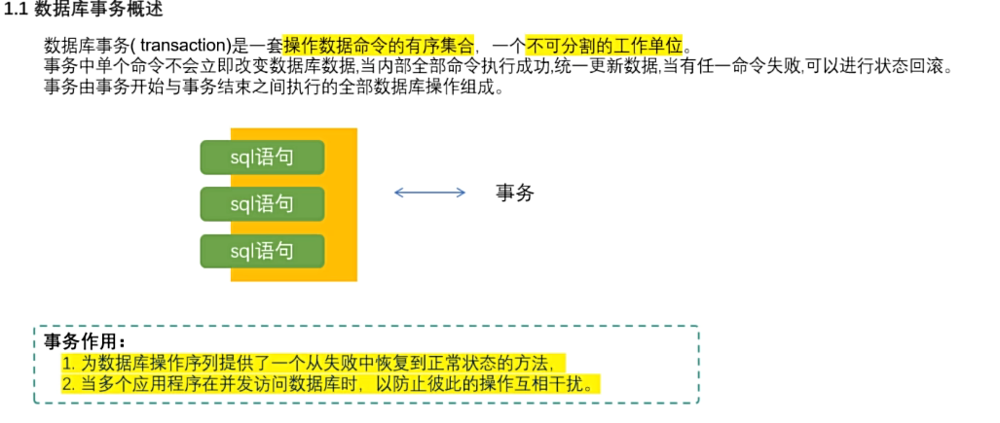
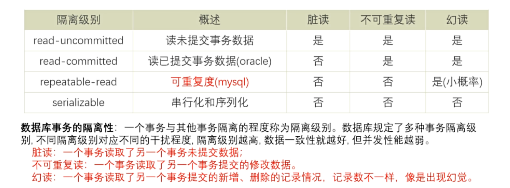

> ACID特性
>
> 1.原子性
>
> 2.一致性
>
> 3.隔离性
>
> 4.持久性

```sql
#开启手动提交事务模式
set autocommit =false;或 set autocommit=0;

#恢复自动提交模式
set autocommit =true;或 set autocommit=1;

#查看是否是自动提交
show varibles like 'autocommit';

#提交和回滚
commit;
rollback;
```

## 开启独立事务

```sql
start transaction;
...
commit /rollback;
```

## 事务隔离

**一个事物内部的操作及使用的数据对并发的其他事务是隔离的，并发执行的各个事务之间不能互相干扰**



```sql
#修改隔离级别
set transaction_isolation='隔离级别';

#查看隔离级别
select @@transaction_isolation;
```
