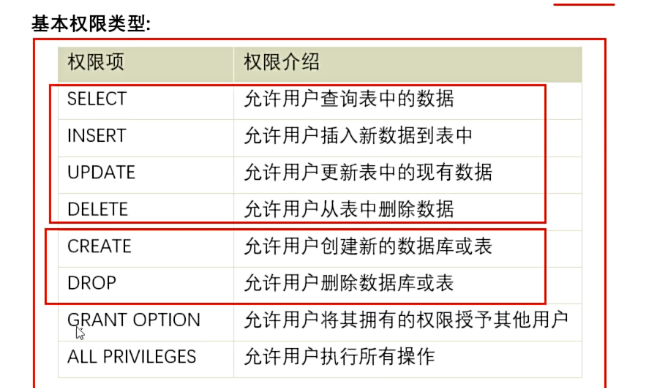
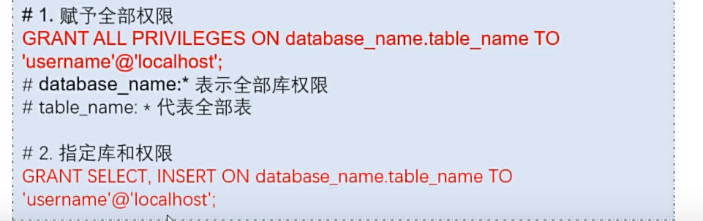
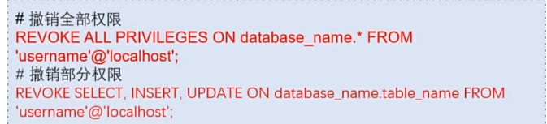
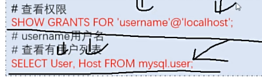

## 基本权限类型



## 创建用户语法

```sql
create user 'username'@'localhost'identified by 'password';
#‘username表示要创建的用户的用户名’
#‘localhost’表示用户可以通过连接到MySQL服务器的本地主机，其中‘%’表示允许来自任何主机的连接
-- create user 'username'@'%'identified by 'password';

#'password'表示要创建的用户的用户名
```

## 赋予权限语法



## 回收权限语法



## 查看语法权限



## 删除用户语法


